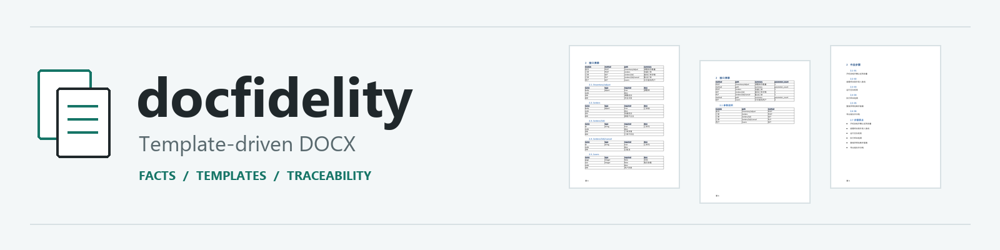
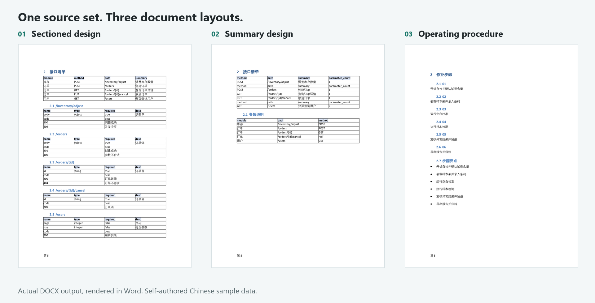

<div align="center">



# docfidelity

**复用已有 Word 中选定的格式，用新材料生成不含旧业务内容的文档。**

[](https://github.com/Hjiassen/docfidelity/actions/workflows/ci.yml) [](CHANGELOG.md) [](pyproject.toml) [](deploy/compose.yml) [](LICENSE)

[简体中文](README.md) | [English](README.en.md)

[快速开始](#快速开始) | [产物预览](#产物预览) | [使用指南](docs/guide/README.md) | [部署指南](deploy/README.md)

</div>

V2 的有效模板与新材料撰写 API 已实现：导入并选择格式，提供文本、Markdown 或 DOCX，确认大纲、逐章生成与编辑，再生成全新 Word。见[有效模板指南](docs/guide/effective-templates.md)和[新材料与撰写指南](docs/guide/documents.md)。当前配置模型已真实生成并采用大纲和正文，关闭或失败可回退规则草稿。下方快速开始和截图仍对应旧浏览器链路；新版工作台属于 M3，状态见[路线图](ROADMAP.md)及[验收](docs/验收/P0-验收自检.md)。

## 快速开始

需要 Git、Docker 与 Docker Compose，三行启动浏览器工作台：

```bash
git clone https://github.com/Hjiassen/docfidelity.git
cd docfidelity
docker compose -f deploy/compose.yml up --build
```

打开 <http://127.0.0.1:8000>，点击“一键创建演示项目”，提交构建后查看报告并下载三份 DOCX。**无需 API Key、真实模板或 Office。** 首次拉取镜像和依赖需要网络。

API 托管前端，独立 worker 消费作业，数据保存在命名卷中。后台启动与持久化见[部署指南](deploy/README.md)；Python 示例与源码工作台见[源码运行](#源码运行)。

当前为 **0.0.1 Alpha**，完整能力边界与待完成项见[使用边界](#使用边界)和[路线图](ROADMAP.md)。

## 产物预览



从左到右为逐节设计、汇总设计、作业程序，均来自发行自制示例的真实构建产物。展示的是 2026-10-08 经 Word 渲染的第 5 页；实际页数取决于排版环境，规则构建本身无需 Office。

查看高清单页：[逐节设计](docs/assets/output-sectioned.png) · [汇总设计](docs/assets/output-summary.png) · [作业程序](docs/assets/output-procedure.png)。输入与复现步骤见[示例说明](examples/README.md)。

## 项目简介

`docfidelity` 将事实接入、内容编排与 DOCX 渲染分开：从外部来源提取事实，按文档类型档案生成内容 IR，再将内容注入已入库的模板。文档类型与领域模型由配置声明，内核不绑定具体业务类型。

内核、HTTP API 与浏览器工作台已实现，技术栈为 Python、Pydantic、OOXML / python-docx、FastAPI、React 与 TypeScript；模型适配使用可选的 OpenAI Agents SDK。Docker、浏览器闭环、当前配置模型和 Word 分页的证据见[验收说明](docs/验收/P0-验收自检.md)。

## 目录

- [适合场景](#适合场景)
- [特性](#特性)
- [架构](#架构)
- [源码运行](#源码运行)
- [配置](#配置)
- [项目结构](#项目结构)
- [开发](#开发)
- [部署](#部署)
- [文档](#文档)
- [贡献](#贡献)
- [使用边界](#使用边界)
- [License](#license)

## 适合场景

- 按既定 Word 模板批量生成文档，同时保留样式、表格原型与来源追溯。
- 将同一批事实源投影为不同结构的文档，通过档案配置管理章节和展示规则。
- 在浏览器中管理模板、项目配置、构建作业与质量裁决。
- 将确定性文档处理与可选模型决策分开，支持模型关闭或不可用时继续构建。

## 特性

| 特性 | 说明 |
| --- | --- |
| 模板保真 | 入库时提取模板包契约；渲染复用基底与同表原型，门禁比对归一化样式结构。 |
| 配置驱动 | 领域模型和文档类型档案声明字段、章节、分组与投影；适配须满足现有连接器与渲染能力。 |
| 可追溯 | 内容 IR 保留事实来源，作业包含阶段事件、质量报告与断点。 |
| 质量裁决 | 规则检查与待确认项进入裁决队列；存在阻断项时不能视为定稿。 |
| 浏览器工作台 | 模板入库、项目配置、构建进度、裁决与产物下载通过同源 HTTP API 完成。 |
| 独立 worker | API 与 worker 共用发行版和持久化存储，支持阶段续跑与事件补推。 |
| 模型可选 | 默认关闭；模型不可用时回退规则并标记待确认，安装后的规则构建可离线运行。 |
| 可复现构建 | 冻结输入且关闭模型与 Office 时，自制示例 DOCX 和结构快照稳定；真实页码需固定排版环境。 |

## 架构

```text
模板原件 -> registry 入库 -> 模板包契约 ----+
事实源   -> ingest       -> 事实包 --------+-> compose -> ContentIR -> render -> DOCX -> qa
领域模型与文档类型档案 ---------------------+                                -> 报告

浏览器工作台 -> HTTP API -> pipeline -> 内核阶段
                             ^
                        独立 worker / CLI
```

`contracts` 为依赖之根；`compose` 不操作 OOXML；模板解析发生在入库期，生成期只读契约。Agent 通过工具做决策，确定性阶段负责文档操作。基础安装不含 Web、数据库或模型 SDK 依赖，架构约束见 [AGENTS.md](AGENTS.md)。

## 源码运行

### Python 示例构建

最低 Python 3.11，当前支持 3.11–3.12。在仓库根目录执行：

```bash
python -m venv .venv
# Linux / macOS: source .venv/bin/activate
# Windows PowerShell: .\.venv\Scripts\Activate.ps1
python -m pip install -e .
python examples/build_demo.py
```

同一批自制事实源生成三份文档：逐节设计、汇总设计与作业程序。DOCX 位于 `var/examples/jobs/*/artifacts/`，报告位于对应作业的 `work/report.json`。安装后示例构建无需模型、数据库或 Office；参数与输入说明见[示例说明](examples/README.md)。

### 从源码启动工作台

另外需要 Node.js ≥ 22.12：

```bash
python -m pip install -e ".[server]"
npm --prefix web ci
npm --prefix web run build
python -m uvicorn server.main:create_app --factory --host 127.0.0.1 --port 8000
```

打开 <http://127.0.0.1:8000>。源码默认使用内存元数据仓储，重启会清空；需要持久化时按[部署指南](deploy/README.md#从源码运行)配置数据库、存储根和模板首启装载。

## 配置

服务端运行参数由 `DOCFIDELITY_` 环境变量或 `.env` 配置，示例见 [.env.example](.env.example)。文档内容与体例由项目配置、领域模型及文档类型档案声明，示例见 [examples](examples/README.md)。

| 配置 | 含义 |
| --- | --- |
| `DOCFIDELITY_STORAGE_ROOT` | 模板、来源、作业与产物的存储根。 |
| `DOCFIDELITY_DATABASE_URL` | 元数据数据库连接；源码默认使用内存仓储。 |
| `DOCFIDELITY_START_WORKER` | 源码单进程可内嵌 worker；Compose 使用独立 worker。 |
| `DOCFIDELITY_SEED_DEMO_TEMPLATES` | 空模板库首启装载自制示例模板。 |
| `DOCFIDELITY_DETERMINISTIC_MODE` | 确定性模式，避免缺省探测本机 Word。 |
| `DOCFIDELITY_MODEL_ENABLED` | 模型总开关，默认 `false`。 |
| `DOCFIDELITY_MODEL_BASE_URL` / `DOCFIDELITY_MODEL_NAME` / `DOCFIDELITY_MODEL_API_KEY` | 模型端点、标识与密钥。 |

启用模型还需安装 `.[model]`，显式配置获授权的 OpenAI 兼容端点，并通过身份匹配的逐点真实基线。模型规格与部署位置不限；模型、样本或路由变化后须重测。未验证的决策点回退规则并标记待确认，详情见[模型与降级](docs/guide/README.md#模型与降级)。

## 项目结构

```text
src/docfidelity/      # 可独立安装的内核
  contracts/         # 契约与错误模型
  registry/          # 模板入库与契约查询
  ingest/            # 事实源接入
  compose/           # 内容编排与 IR
  ooxml/             # OOXML 操作与归一化
  render/            # DOCX 渲染
  qa/                # 质量规则与报告
  model/ agents/     # 可选模型适配与决策工具
  pipeline/ builder/ # 阶段执行、断点与 CLI
  platform/          # 文件系统、日志与基础设施
server/              # HTTP API、持久化与 worker
web/                 # React + TypeScript 工作台
deploy/              # Dockerfile、Compose 与部署指南
examples/            # 自制事实源、档案与构建示例
demo-templates/      # 自制模板资产
tests/ scripts/      # 回归测试与工程门禁
docs/                # 需求、设计、格式规范与使用指南
```

## 开发

```bash
python -m pip install -e ".[dev,server,model]"
ruff check .
ruff format --check .
mypy src/docfidelity server
lint-imports
pytest -m "not e2e"
npm --prefix web ci
npm --prefix web run build
npm --prefix web test
```

CI 分别验证纯内核安装、完整依赖安装、前端契约、分发包与 Docker 空卷首启。完整门禁、生成契约同步与提交要求见[贡献指南](CONTRIBUTING.md)。

## 部署

默认面向单团队自部署，仅绑定回环地址，无内建身份认证。向其他机器开放前须配置带身份认证与 TLS 的前置代理。

Compose 使用同一镜像运行 API 和独立 worker，数据存于命名卷 `df-data`。停止容器保留数据；`down --volumes` 会删除卷。源码部署需自行配置持久化和迁移；核心 wheel 不包含服务端包。完整命令、备份和运维说明见[部署指南](deploy/README.md)。

## 文档

| 文档 | 说明 |
| --- | --- |
| [使用指南](docs/guide/README.md) | 构建、模板、档案、模型与质量报告。 |
| [新材料与撰写](docs/guide/documents.md) | M2 API 的材料、大纲、章节与可恢复运行流程。 |
| [示例说明](examples/README.md) | 自制输入、三类档案和重复构建。 |
| [部署指南](deploy/README.md) | Docker、源码持久化、worker 与运维。 |
| [需求](docs/需求/需求.md) | 产品范围、硬约束和验收标准。 |
| [详细设计](docs/设计/开发设计文档.md) | 模块边界、契约与实现设计。 |
| [格式规范](docs/spec/README.md) | 模板包、档案与内容 IR 的对外契约。 |
| [架构决策](docs/design/adr/README.md) | 关键设计取舍。 |
| [验收说明](docs/验收/P0-验收自检.md) | 实测证据、未通过项和验证边界。 |
| [路线图](ROADMAP.md) | 剩余工作的日期、依赖与完成标准。 |
| [贡献指南](CONTRIBUTING.md) | 开发环境、测试与提交要求。 |
| [安全策略](SECURITY.md) | 漏洞报告和敏感数据处理。 |
| [治理](GOVERNANCE.md) / [行为准则](CODE_OF_CONDUCT.md) | 项目决策和社区协作。 |
| [变更记录](CHANGELOG.md) | 版本变化与迁移影响。 |

## 贡献

缺陷与建议请提交 [Issue](https://github.com/Hjiassen/docfidelity/issues)，仅附自造、脱敏数据。代码、连接器、档案、测试与文档贡献请先阅读[贡献指南](CONTRIBUTING.md)和[行为准则](CODE_OF_CONDUCT.md)。安全问题按[安全策略](SECURITY.md)私下报告。

## 使用边界

模板保真以归一化样式结构和模板包契约为依据，不承诺整个 DOCX 的原始字节不变。真实页码依赖 Word、字体和打印环境；结构快照不能代替分页实测。

默认构建支持未绑定内容的模型章节落位，需显式准入策略及身份匹配的真实基线。当前配置模型的落位基线为 `10/10`，真实默认构建采用 5 次决策；其他决策点仍因缺置信度由规则接管，默认关闭模型。配置方法见[使用指南](docs/guide/README.md)，完整缺口见[验收说明](docs/验收/P0-验收自检.md)。生成文档须审核质量报告与待确认项；开发夹具服务器 `scripts/serve_dev.py` 的固定报告不能用于功能验收。

Word COM 与 PDF 目检属于可选能力。PyMuPDF 采用 AGPL 或商业许可，安装 `office` extra 前应核对使用方式，许可证边界见 [NOTICE](NOTICE)。`.env`、真实模板、事实源和运行数据不应提交到仓库。

## License

代码与自制示例采用 [Apache-2.0](LICENSE)。第三方组件及可选能力的许可见 [NOTICE](NOTICE)。
