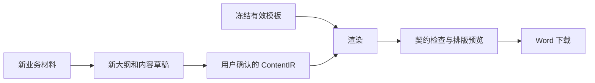

# Docfidelity V2 产品重构方案

日期：2026-10-14，进度更新：2026-10-28。状态：已批准；M0–M2 核心与 API 已实现，执行清单见 `M0-M1实施计划.md` 与 `M2实施计划.md`，证据与限制见 `../验收/P0-验收自检.md`。

本方案依据用户最新目标与当前仓库源码制定。实施后替换旧产品主流程；旧配置不作为 V2 的兼容承诺。本文不宣称当前代码已满足新版验收。

## 1. 产品目标与范围

**上传已有 Word 文档作为格式来源，提供新项目内容，生成采用所选格式、没有旧业务内容的全新 Word 文档。**

验收示例：聊天软件设计文档提供格式，购物软件材料提供内容。产物继承字体、标题样式、编号和用户选择的封面等布局；“消息发送”等业务章节由新内容替换，旧产品名称、正文、表格数据、截图和修订历史不继承。

首版范围：

- 格式来源为 `.docx`；新内容支持粘贴文本、Markdown 和 `.docx`。
- 用户选择页面设置、正文与标题格式、编号、封面、页眉页脚、目录、表格版式和固定素材。
- 提供新大纲确认、按章节编辑内容、真实模型整理与撰写、预览和下载。
- 模型关闭或失败时，按新材料的标题与顺序组织草稿，缺项标为待确认。
- 一次生成一份文档；本地部署与 Docker 使用同一套核心流程。

新材料中的 DOCX 主要读取正文标题、段落、表格与图片，并保留来源定位；它的封面和排版不会覆盖所选模板。无法读取的内容要列出，不能静默缺失。

后置范围：PDF 作为格式来源、旧 `.doc`、完整 Word 编辑器、代码/ORM/OpenAPI 自动抽取、跨文档批量编排、增量补写旧文档、领域建模与投影 DSL、漂移监控、复杂多 Agent 自主规划。

首版不承诺任意复杂 Word 布局均可无损提取。无法可靠复用的嵌入对象、复杂图表或浮动组合对象必须列出，用户可以排除；被选中的不支持对象不能静默丢失。

## 2. 改造方式

| 方式 | 收益 | 成本与风险 | 结论 |
| --- | --- | --- | --- |
| 原仓库重做产品层，保留底层文档能力 | 复用 OOXML、几何、编号、样式、分页及作业基础；GitHub 地址和历史继续使用 | 中层契约与主流程需要明确替换 | 推荐 |
| 全量新建仓库并重写引擎 | 可以完全重新组织代码 | 重新解决 Word 分节、表格、编号、图片和关系依赖；回归范围最大 | 只有底层能力验证失败才考虑 |
| 在旧向导上增加复选框 | 早期界面改动较少 | 原件复制、旧业务清理、强制档案和投影流程仍存在 | 不作为本次方案 |

当前代码的可用基础是“内容 IR 与渲染解耦”和 OOXML 操作能力。需要替换的是“领域事实 + 预设档案 + 投影槽位”作为用户必经路径的设计。

源码依据：

- `src/docfidelity/compose/builder.py`：默认装配依赖领域对象、档案骨架和投影规则。
- `src/docfidelity/builder/stages.py:225`：当前 compose 阶段主要接入模型章节落位；它不能替代新版大纲与正文生成。
- `src/docfidelity/agents/instructions.py`：现有 architect 在给定章节中选择，不能生成新大纲。
- `src/docfidelity/render/pipeline.py:228`：渲染保护已登记版块；用户选择尚未成为有效模板的完整生成规则。
- `src/docfidelity/render/blocks.py:226`：现有占位清理不能覆盖所有普通旧业务文字。
- `src/docfidelity/render/context.py`：生成期仍从工作副本采集原型；V2 应在入库时冻结原型及其引用。

“保留”表示进入复用候选并通过对应测试，不代表未经验证直接沿用。

## 3. 最重要的数据分离

系统区分四种对象：

| 对象 | 存储内容 | 使用范围 |
| --- | --- | --- |
| 上传原件 | 完整旧文档，只读保存 | 导入预览、人工定位、追溯；生成工作区不复制原件 |
| 导入草稿 | 识别候选、用户选择、范围纠正、变量和素材确认 | 可恢复、可修改，尚未冻结 |
| 有效模板 | 所选格式、清理过的布局、空原型、确认的固定素材和冻结契约 | 渲染使用；模型只取得经过筛选的结构能力摘要 |
| 新文档草稿 | 新材料、大纲、正文、来源引用和待确认项 | 模型整理、用户编辑与生成 |

模板原件中的正文不得成为默认生成事实源。封面和页眉中的旧名称也属于旧业务内容。

图片必须区分格式与内容。图注样式可以复用；旧业务截图默认不保留。Logo、章印等固定素材只有用户确认后进入有效模板。

“引言、总体设计”等通用章名可以作为可选结构建议。“消息发送”等业务标题不自动进入新大纲。默认以新材料的结构生成，沿用通用结构由用户显式选择。

## 4. 两条用户流程

### 4.1 从已有文档创建模板

1. 上传 Word：显示文件名与处理状态，解析和预览异步执行。
2. 预览与选择：左侧保留项和结构树，右侧文档预览；勾选封面等布局，确认旧文字的替换字段和固定素材。
3. 保存：填写模板名称，核对保留摘要与清理结果，创建不可变模板版本。

每个候选独立表达“检测状态”和“用户选择”。检测状态包括已识别、需确认、未识别、用户确认不存在；选择为保留或跳过。

未识别项默认不勾选，允许手动定位。没有封面或用户不需要封面时，直接跳过，不强制增加确认步骤或自动生成封面。用户想保留但系统定位不确定的区域，需要确认后才能冻结。

人工纠正作用于结构树中的完整节点范围，不以页面像素或单个页码作为删除依据。页眉页脚按分节、首页、奇偶页与继承关系展示。

每个保留项支持的动作明确为：保留格式并替换文字、保留已确认固定素材、跳过。旧修订记录可保留空表版式，旧历史行清除。

### 4.2 使用模板生成新文档

1. 选择模板，填写新文档名称，粘贴或上传新材料。
2. 系统整理新大纲，用户可以改名、调整顺序和增删章节；每项对应持久配置。
3. 模型按已确认大纲逐章撰写，用户查看并修改草稿；不足的信息进入待确认。
4. 按冻结模板渲染，预览文档与问题，下载 Word；修改内容后可以重新生成。

两种生成模式：

- `format_only`：直接将新材料的标题、段落、表格和图片组织为 IR，不调用模型。
- `organize`：模型依据新材料整理大纲与表达，默认不新增无来源的业务事实。模型不可用时回退到 `format_only` 并显示待确认。

首版不提供无约束扩写。仅输入项目名而无业务材料时，生成可编辑大纲与缺项清单，正文保持待补充；不能从旧文档填充事实。

## 5. 页面与视觉设计

顶层导航收敛为“文档、模板、设置”。工作区可由系统自动创建，普通用户无需先建立领域模型或文档类型档案。

| 页面 | 主要内容 | 主动作 |
| --- | --- | --- |
| `/documents` | 最近文档、草稿、处理中和需确认状态 | 新建文档 |
| `/templates` | 真实缩略图、名称、保留项摘要和版本 | 从文档创建模板 |
| `/templates/import` | 上传、保留项、结构定位与原件预览 | 保存模板 |
| `/templates/:id` | 有效模板预览、变量、保留项和版本 | 使用模板 |
| `/documents/new` | 选择模板与新材料 | 整理内容 |
| `/documents/:id` | 大纲、章节内容、预览与检查结果 | 生成文档或下载 |
| `/settings` | 模型、存储与预览能力 | 保存设置 |

导入工作台：

```text
模板名称                                      [保存模板]
-------------------------------------------------------
保留项与结构树             文档预览
[x] 页面与段落格式         页缩略图 | 白色纸张
[x] 标题格式和编号
[ ] 封面：未识别           点击节点定位区域
[x] 页眉页脚               无精确映射时不伪造高亮
[x] 目录样式
[x] 表格版式
[ ] 固定素材
-------------------------------------------------------
[上一步]                        [保存草稿] [下一步]
```

新文档工作台使用“大纲 / 当前章节 / 文档预览”三个区域。窄屏切换为大纲、内容、预览标签，底部动作固定；保持内容区域的稳定尺寸。

视觉采用中性工作区与白色纸张，清晰的文字对比度、少量状态色和紧凑工具栏。支持现有浅色/深色主题；页面区域使用平面布局，避免嵌套卡片。

复选框用于保留项，分段控件用于生成模式，图标用于缩放和预览操作，图标带 tooltip。沿用 React、TypeScript 和 TanStack Query；图标使用 `lucide-react`，PDF 预览采用 PDF.js。

文件哈希、路径、契约和模型调用详情放在高级抽屉。操作失败必须指向具体项，并给出重试或修改入口。上传进度、解析状态、预览不可用、保存冲突、取消与恢复均为首版状态。

## 6. 有效模板的生成方式

### 6.1 入库阶段


1. 为原件的段落、表格、文本框、分节和相关部件建立稳定节点索引。节点 ID 在该原件摘要范围内有效，不跨文档混用。
2. 保存格式定义，以及标题各层级、正文、列表和不同表格的原型。段落和 run 的直接格式也要保留，不能只保存具名样式。
3. 用户确认候选范围、替换字段和固定素材。检测默认值来自服务端，前端收集选择。
4. 从选中内容组装有效模板。正文实例清除，原型去掉旧文本；封面、页眉、文本框等保留布局但清空旧文字或转换为明确变量。
5. 目录保留格式与域，旧条目清除；修订表旧数据清除；注释、修订痕迹、旧属性和未授权嵌入内容不带入。
6. 建立所需部件和关系的白名单。仅复制选中节点实际需要且已确认的素材，不复制原件整包中的无关图片、附件和外链。
7. 在入库阶段解析有效模板并冻结新定位符，避免原件裁剪后定位符漂移。用户改变选择时生成新草稿或版本。
8. 校验用户选择与有效材料一致，再登记版本；选中的不支持对象给出明确错误与排除入口。

有效包建议包含 `effective.docx`、`selection.json`、`contract/`、`prototypes/`、`assets/` 和 `cleanup-report.json`。上传原件保存在独立只读区域。

包摘要覆盖归一化有效材料、格式契约、原型、素材及用户选择。选择文件中的审计时间单独记录，不能把影响生成的选择当作无关 overrides 排除在摘要外。

### 6.2 生成阶段



渲染只读取冻结契约、已登记的有效模板材料和原型。不得重新解析原件，不得从整篇文档重新猜测正文或表格原型，不得与原件重新比对。

表格原型可以有多种，每个原型使用自己的行模板。新表的列数不匹配时按声明式策略处理并提示，不能拿修订表作为通用业务表兜底。

模板没有某级标题、表格或图片格式时，服务端返回可选的明确替代方案；用户确认后写入配置。原型缺失不能静默丢弃新内容。

取消封面、目录或页眉必须体现在有效材料及产物中。QA 按启用契约检查，未选择的版块不算缺项。

## 7. 内容生成与模型

模型使用现有 `.env` 中配置的端点和模型，通过现有设置入口读取，不增加模型规模要求，不把密钥写入文档、前端或日志。

内容生成分成大纲整理和逐章撰写，均有结构化输出契约。新大纲不受旧业务章节或旧投影槽位限制。

新增 `ContentGenerator` 协议及大纲/章节请求，不把生成文字塞进只适合候选选择的旧 `DecisionRequest`。组合根注入生成适配器，业务模块只认识输入输出契约；原模型连接、开关和调用留痕按需要复用。

模型输入仅包含：新材料片段、用户要求、已确认大纲，以及筛选过的通用结构能力摘要。模板原件、旧正文、旧修订表和未确认旧章名不进入生成上下文。

模型输出包含章节或内容块、来源引用和缺项。服务端校验引用是否来自本次新材料、结构是否合法、数字等明确事实是否一致；来源引用存在本身不能证明语义正确，仍需真实评测和用户审阅。

超时、不可达、输出不合法或截断：有限重试，随后保留新材料并按规则组织草稿，标记待确认。模型失败不丢弃已编辑或已成功生成的章节。

大纲和正文生成的正确性分别验收，不能用旧章节落位的基线成绩替代。记录实际模型、提示版本、材料摘要、用量、降级原因以及哪些生成内容被采用。

模型只输出语义内容，不得输出 OOXML、样式 ID、绝对列宽或布局指令。SDK 仍隔离在可选适配层，`compose` 不直接导入 SDK 或 `agents`。

用户确认的内容保存为不可变修订。同一模板版本和内容修订重复渲染应归一化一致；重新调用模型可能产出不同草稿，不承诺模型采样结果相同。

## 8. 数据契约与 API

以下均为拟新增或改造契约，不是现有接口。

| 契约 | 核心字段与职责 |
| --- | --- |
| `ImportDraft` | 原件引用与摘要、处理状态、节点索引、识别候选、草稿修订 |
| `TemplateSelection` | 页面/格式选择、保留范围、变量映射、固定素材、可选通用结构 |
| `TemplateVersion` | 格式版本、有效材料引用、冻结原型、样式/编号/分节契约、内容清理规则 |
| `FormatBindings` | 标题层级到原型、正文/列表原型、表格变体、图表注、变量和明确回退策略 |
| `SourceMaterial` | 新材料 ID、类型、内容块、附件、定位与摘要 |
| `DocumentDraft` | 名称、模板版本、新材料引用、生成模式、大纲、内容修订、变量值和待确认 |
| `GenerationRun` | 输入快照摘要、阶段、模型配置身份、取消/失败、产物与检查结果 |

`ContentIR` 保留标题、段落、列表、表格和图片等语义单元，来源改为新材料块或用户编辑记录。移除必填 `profile_id` 与领域投影身份的主流程要求，保留稳定内容单元 ID。

渲染与 QA 的必填 `DocTypeProfile` 依赖一并替换为有效模板的 `FormatBindings`。格式绑定来自用户选择的模板，IR 只声明语义与层级；不能只改前端或 IR 字段，却继续要求后台提供旧档案。

配置持久化：导入选择写入 `imports/<id>/selection.json`；冻结后随模板版本保存；新文档的名称、模式、模板引用和大纲写入 `documents/<id>/document.json`，编辑正文写入对应内容修订。所有可编辑控件都有明确配置字段。

数据库存元数据索引、作业与事件。配置文件和内容快照是可复现输入，不能让前端 `useState` 成为导入或生成进度的唯一存储。

建议 API：

| 操作 | 接口 |
| --- | --- |
| 上传与读取导入草稿 | `POST /api/v2/template-imports`、`GET /api/v2/template-imports/{id}` |
| 自动保存选择 | `PUT /api/v2/template-imports/{id}/selection` |
| 冻结模板 | `POST /api/v2/template-imports/{id}/finalize` |
| 模板列表与详情 | `GET /api/v2/templates`、`GET /api/v2/templates/{id}` |
| 读取不可变模板版本 | `GET /api/v2/templates/{id}/versions/{version}` |
| 创建、读取与保存新文档 | `POST /api/v2/documents`、`GET/PATCH /api/v2/documents/{id}` |
| 整理大纲与逐章撰写 | `POST /api/v2/documents/{id}/outline-runs`、`POST /api/v2/documents/{id}/content-runs` |
| 渲染与结果 | `POST /api/v2/documents/{id}/render-runs`、`GET /api/v2/runs/{id}` |
| 事件、取消和产物 | `GET /api/v2/runs/{id}/events`、`POST /api/v2/runs/{id}/cancel`、`GET /api/v2/runs/{id}/artifacts` |
| 异步预览状态 | `GET /api/v2/previews/{id}` |

上传返回可恢复的导入 ID；昂贵操作返回运行 ID。自动保存采用修订号或 ETag，冲突返回 409。生成按输入快照与幂等键去重，执行时冻结材料和配置，避免运行中读取后来编辑的值。

文档绑定明确的模板版本，不在执行时解析“最新版本”。保存先原子落盘修订快照，再更新数据库中的已提交引用并发布事件；失败不回执成功，重启按已提交修订恢复，未引用快照后续回收。

前端提交勾选和编辑，不判断模板是否可冻结、是否应阻断、模型是否成功或是否通过检查。这些结论由服务端返回。

## 9. 模块处置与文件边界

| 现有模块 | 处置 |
| --- | --- |
| `platform`、`ooxml` | 复用文件、几何、样式、编号、包与关系能力；补节点读取和清理能力，保持纯函数边界 |
| `contracts` | 复用通用契约根；改造模板和 IR，新增导入、材料、文档、生成契约 |
| `registry` | 重做候选、人工范围、清理、有效模板冻结；复用样式/页面/编号解析基础 |
| `render` | 复用表格、图片、分页等能力；替换整篇采集原型和原件保护策略，新增变量替换 |
| `compose` | 主流程改为新材料、大纲和内容修订到 IR；替换强制领域投影与固定槽位装配 |
| `ingest` | 增加文本和 Markdown 材料规范化，使用成熟 Markdown 解析器；保留来源、摘要与校验 |
| `agents` | 保留需要的调用适配、记录与有限重试；新增大纲和章节生成任务，删除未使用角色与工具 |
| `pipeline`、`builder` | 复用作业、事件、快照、取消与续跑能力；重接新流程与阶段，缩减无实际动作的阶段 |
| `server` | 保留上传、安全校验、存储和 worker 基础；替换旧配置/档案产品 API，新建文档草稿用例 |
| `web` | 重做导航和主要页面；复用 HTTP、服务端状态与事件订阅基础 |
| `model` | 当前负责领域投影，不是大模型客户端；从新版主链移除，调用方替换后删除无用途部分 |

建议新增职责文件：

- `contracts/imports.py`、`materials.py`、`documents.py`、`generation.py`：上述数据契约。
- `registry/candidates.py`、`selection.py`、`sanitize.py`、`freeze.py`：候选、选择验证、清理和冻结。
- `ooxml/text.py`、`primitives.py`：通用节点读取与空原型操作，不包含具体文档类型或业务词。
- `compose/outline.py`、`draft.py`、`assembly.py`：大纲规则、模型草稿验证、语义 IR 组装。
- `agents/writing.py`：模型大纲与章节任务；通过契约与 pipeline 工具面交互。
- `pipeline/documents.py`、`materials.py`、`previews.py`：对服务端公开的用例门面。
- `render/variables.py`：按冻结变量定位替换封面、页眉及文本框中的文字。
- `qa/rules/checks_residue.py`：依据冻结排除规则和素材契约检查旧内容残留。
- `server/api/documents.py`、`template_imports.py`：新版 HTTP 入口；前端按用户页面命名，替换 P01–P14 编号命名。

DOCX 新材料的底层读取位于 `ooxml`，由 `pipeline/materials.py` 接成规范化材料；`ingest` 不导入 `ooxml`。`server` 只调 `pipeline` 用例，不直接操纵 OOXML。

当前 `pipeline/decisions.py` 与 `.importlinter` 允许 pipeline 导入 agents，但用户提供的 AGENTS.md 将 agents 放在 pipeline 工具面之上。实施前在 M0 对齐这一不一致：模型协议归入契约，由组合根注入适配器；pipeline 通过协议调用，agents 只依赖契约与工具面，不形成循环。

AGENTS.md 中“Agent 只做决策”需要明确为“模型可产出结构化内容草稿，但不得直写 OOXML”。模板前置解析、原件只读、内核零 Web/DB、类型无关和单文件 800 行等硬规则继续执行。

## 10. 旧代码与文档清理

实现替换后，删除旧默认链路的领域档案、投影 DSL、配置编辑页、领域模型页、漂移页及未使用 Agent 工具。相应 API、契约、入口点、示例、依赖和测试同步处理，不能只移除导航。

旧 P01/P02 改为文档工作台；P03/P04/P05 改为模板库、详情与导入；P07 配置、P08/P09 作业、P10 报告、P11 产物的用户功能收敛到文档详情；全局裁决页和漂移页从首版移除。

不按文件大小或测试是否失败决定删除。每批删除必须确认新流程已有替代、生产入口无引用、数据和事件无遗留消费者；失效旧测试移除时增加新目标的回归用例。

最终文档入口收敛为：中英文 README、需求、开发设计、验收、部署和贡献说明，以及必要 ADR/格式规范。旧大范围目标从当前需求和路线图移除，由 Git 历史追溯；公共治理、许可证和安全文件保留。

本提案实施后并入需求/开发设计及路线图，删除重复的方案文件，避免长期并存多份相互矛盾的设计。真实上传材料和运行证据只在被忽略的私有目录中保存。

## 11. 预览、失败与运行约束

复用现有 Word COM / LibreOffice 转 PDF 基础，新增异步预览缓存和 PDF.js 页面。预览提供者、版本、字体缺失和排版差异随结果返回。

M0 确认预览依赖与字体的分发许可。浏览器采用 PDF.js；服务端缩略图与 PDF 文本读取优先验证 `pypdfium2`，避免直接把现有可选 PyMuPDF 依赖扩大为 Apache-2.0 发行版的必装依赖。所选提供者在预览 extra 和部署中明确声明。

Windows 桌面优先用 Word；Docker worker 配置 LibreOffice 与可分发字体。两种引擎可能产生不同分页，不能把 LibreOffice 结果宣传成 Word 完全一致。Word 自动化按串行任务、超时与进程隔离运行，打开输入为只读且不更新外链。

首版范围选择依赖结构树节点。PDF 与节点的精确映射仅在可验证时启用；重复文本或无法映射时，预览供参照，选区仍按结构节点记录。精确映射不是用页数反推结构或图片几何。

无预览引擎时，结构选择和 Word 生成仍可运行，界面显示预览未执行，不冒充视觉验证成功。若所选布局无法可靠提取，则该项必须调整或排除。

模型失败是草稿降级；输入文件损坏、冻结契约不完整和样式关系损坏是明确错误。取消操作完成后不再发布迟到结果，已保存编辑不会丢失。

沿用 API 与 worker 分离、结构化事件及断点机制，不增加微服务、向量数据库或新的多 Agent 编排框架。

## 12. 新版验收

| 编号 | 场景 | 必须通过的结果 |
| --- | --- | --- |
| V2-01 | 聊天格式来源 + 购物材料 | 产物业务来自购物材料，格式来自所选模板 |
| V2-02 | 封面/页眉有旧产品名 | 新名称正确替换，布局保留；旧名称不残留 |
| V2-03 | 原件无封面/无目录 | 不勾选即可生成，无缺项阻断和自动补版块 |
| V2-04 | 有封面但系统漏识别 | 可人工标记完整范围并生成，不把正文误保留为封面 |
| V2-05 | 取消保留版块 | 产物没有该完整版块；重新打开选择可恢复 |
| V2-06 | 旧业务位于特殊部件 | 正文、表格、文本框、页眉页脚、修订表、批注、属性、旧图片和嵌入对象中的专属测试标记不残留；通用固定素材按确认保留 |
| V2-07 | 新材料结构不同 | 用户能增删章和改标题，不依赖旧业务章节或领域配置 |
| V2-08 | 新内容含表格与图片 | 选择正确原型、同表行克隆、只缩不放；不丢数据和图注 |
| V2-09 | 模型开启 | 使用当前配置模型；真实生成的大纲与章节被采用，有调用、用量和结果证据 |
| V2-10 | 模型关闭/超时/非法输出 | 仍生成来源明确的草稿，缺项待确认，不复用旧业务事实 |
| V2-11 | 刷新、重开、worker 重启 | 导入选择、正文编辑、运行与事件可恢复；冲突和取消正确处理 |
| V2-12 | 同输入重复渲染 | 冻结模板和内容后连续 3 次归一化一致，调用栈无 TemplateParser |
| V2-13 | 普通用户浏览器闭环 | 上传格式文档、勾选、新材料、模型生成、修正、下载全过程无需 CLI/JSON/YAML |
| V2-14 | Windows + Docker | 两种环境走通闭环，说明预览能力、字体与差异；模型关闭零模型请求 |
| V2-15 | 桌面与窄屏 | 文本和工具不重叠、主动作可达、无不可控横向滚动；补键盘和焦点验证 |

残留检测依据入库阶段冻结的内容排除与素材清单，生成期不重新解析原件。测试使用自制模板，并在多个部件放入专属标记；正文关键词检查不能单独证明全包清理正确。

基础检查沿用 `lint-imports`、禁用词、内核无 Web/DB、行数、严格类型与核心单测。增加模板清理、变量替换、材料导入、模型结果验证和浏览器端到端用例。保留仍适用的旧底层测试；不以旧 suite 数量作为新版完成度。

## 13. 阶段与粗估

按单人专职、顺序执行粗估 18–28 个工作日，约 4–6 周。M0 对预览、复杂封面与文字替换做短验证后再修正工期；不将旧 R1/R2 的落位验收当作新版撰写完成。

| 阶段 | 粗估 | 交付与退出条件 |
| --- | --- | --- |
| M0 需求收敛与技术验证 | 1–2 天 | 更新需求边界与依赖纪律；自制旧/新业务样例；验证直接格式、文本框、分节、空原型和预览路径 |
| M1 有效模板闭环 | 4–6 天 | 候选、用户选择、清理、冻结及变量；通过 V2-02 至 V2-06；可以生成无旧业务内容的有效包 |
| M2 新内容与模型闭环 | 3–5 天 | 新材料、大纲、逐章草稿、IR 和回退；真实模型生成被采用；通过 V2-07、V2-09、V2-10 |
| M3 新工作台闭环 | 4–6 天 | 模板预览选择与新文档工作台、自动保存、编辑、检查及下载；通过 V2-13、V2-15 |
| M4 真实跨环境验收 | 4–6 天 | Windows/Word、Docker/LibreOffice、特殊部件、分页、重启与取消；通过 V2-01、V2-08、V2-11、V2-12、V2-14 |
| M5 删除旧链路与发布整理 | 2–3 天 | 删除无用途代码/API/依赖/测试；更新双语 README、示例和部署；远端 CI 与发布复核 |

M1 是关键路径。有效模板清理不可靠时，先修正清理能力，不能用界面完成或模型成功掩盖它。

旧路线图中的预览、可用性、网络出口、Docker 和发布检查并入上述阶段；旧领域生态、增量与漂移目标退出首版排期。

## 14. GitHub 与数据处理

继续使用现有 `docfidelity` 仓库。实施时在 `codex/v2-document-workflow` 分支工作，将现有版本保留为可回退标签，通过按阶段提交和 PR 替换主分支内容。

不需要清空 Git 历史或重新创建仓库。旧源码从新版分支删除后仍可在历史标签查阅；不存在维护两套默认主流程的要求。

V2 使用独立存储目录和格式版本。旧模板配置不静默迁移，用户重新导入原件并确认选择；已有产物与私有存档保留。切换前提供导出/备份与回退说明，不删除旧数据卷。

M5 删除清单以实际引用、入口和替代验收为依据。发布产物、示例模板与截图全部使用自制内容；现有 `.env` 密钥和真实用户文档不得提交。

## 15. 本轮交付

设计阶段仅交付方案；M0/M1 已实现有效模板核心与 API，实际验证状态以验收文档和 Git 提交为准。现有工作区的未提交修复继续保留。

M2 已接入新材料、大纲与逐章正文，真实模型采用、规则降级、修订与可恢复运行已验证；下一实施阶段为 M3 新版工作台。M1/M2 的结构与接口证据不替代 M4 的 Word/LibreOffice 视觉与分页验收。
