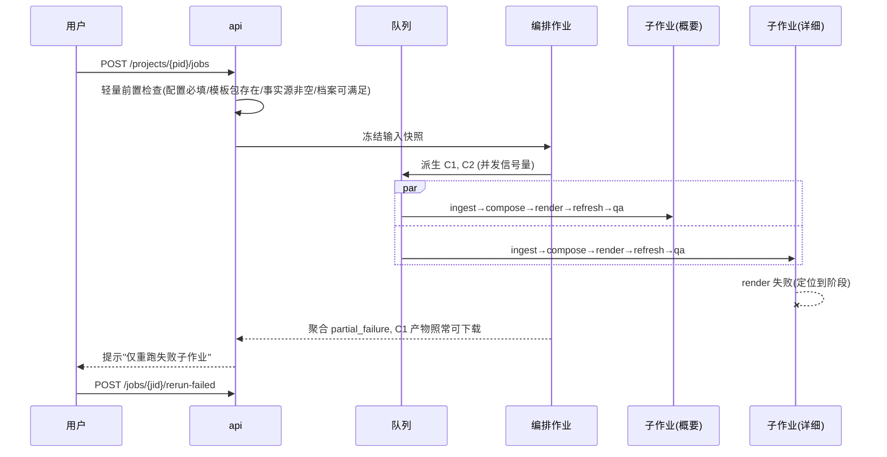
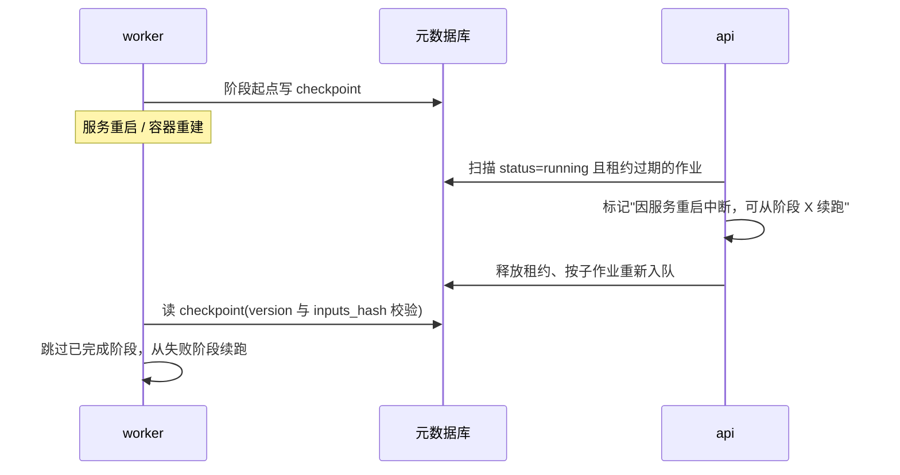
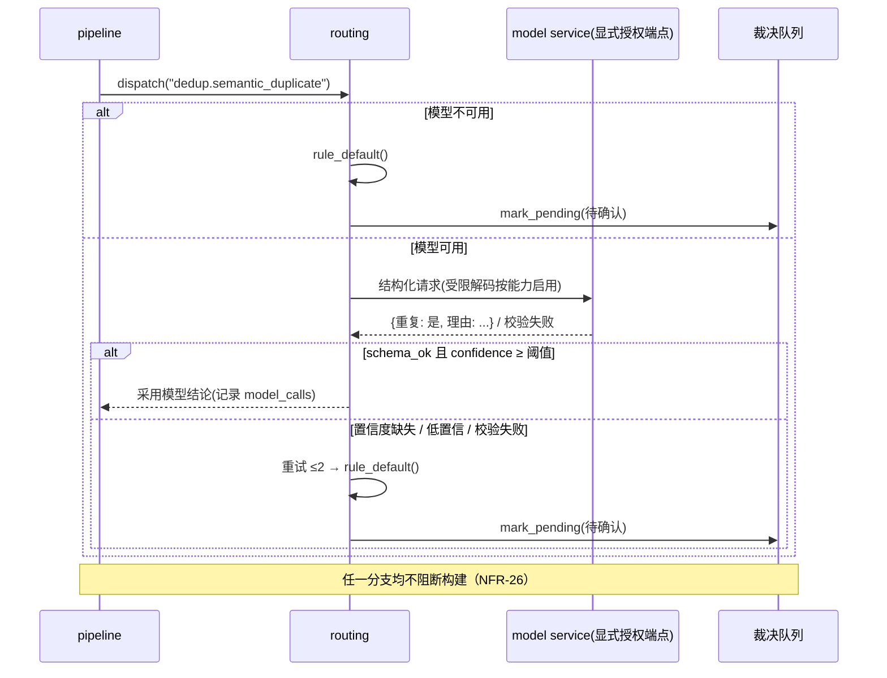

# Docfidelity 开发设计

## V2 生效设计（2026-10-14）

V2 分离格式来源与新业务材料。上传原件仅是导入资产；生成资产是按用户选择清理并冻结的有效模板。V1 保护块、领域模型、DocTypeProfile 和投影 DSL 不作为 V2 必经路径，下方旧章节暂供存量回归。

### 模块与契约

contracts 定义 ImportDraft、TemplateSelection、TemplateVersion、FormatBindings 及共享模型协议，只依赖标准库/pydantic。registry 构造候选、验证范围、清理与冻结；render 消费冻结包与原型；pipeline 提供用例。server 不能导入 registry/render/ooxml。模型实现 agents 位于 pipeline 之上，组合根发现发行入口点并注入协议实例；规则会话不加载 agents。

V2 IR 可省略档案身份。M2 增加独立 ContentGenerator、大纲和章节协议，不把写作塞进旧 DecisionRequest。M1 不新增模型撰写调用。实施步骤见 `M2实施计划.md`。

M2 材料由 `SourceMaterial` 保存不可变来源摘要和有序块，引用采用 `material_id/block_id`。文本与 Markdown 由 ingest 处理，DOCX 的底层读取在 ooxml，由 pipeline 组合；server 不操纵 OOXML。图片以受控逻辑名和独立资产保存，不跟随材料中的外链抓取。

`DocumentDraft` 绑定模板具体版本、材料引用、生成模式、大纲确认状态、正文编辑标记和变量。`GenerationRun` 冻结输入修订与材料，记录提示版本、模型身份、用量、采用/回退、逐章断点和结果候选。自动采用须在同一提交锁内检查取消及输入修订，晚到的候选不能覆盖用户后来保存的编辑。

### 有效模板

原件独立存档，包包含 `effective.docx`、`selection.json`、`contract.json`、`prototypes/`、`cleanup-report.json`。正文范围只提供空原型，布局范围清空旧文字，固定图片需确认。批注、属性、嵌入部件、外链排除；按白名单重建关系闭包，不能复制原包后仅过滤索引。

变量和内容插入位置使用冻结内容控件标记。标题/正文保留段落及 run 直接格式，表格保存自己的行原型。读取 XML sidecar 是消费冻结原型，不进行语义采集。选择与全部渲染文件参与摘要；审计时间和原件路径不参与。

`TemplateSelection.formats` 分别保存 `page_setup`、`heading`、`body`、`numbering`、`tables`，默认复用对应源格式。关闭表示在导入期冻结明确基础格式，不能让新内容消失，也不能留着原样式继承链间接恢复被取消的格式。基础页面为 A4、四边 1 英寸；正文 Arial 11pt、标题 Arial 14pt；取消编号同时移除段落和样式的编号引用，表格采用无样式基础版式。后续界面提交同一配置，不自行判断格式。

取消源编号继承不取消新材料的有序/无序列表语义。有效包保留空中性编号部件，渲染器添加本次列表使用的编号定义，不带入源编号的业务文字。

取消源表格格式时冻结单格中性表格与自己的行原型，列策略显式为 `flexible`。渲染按新内容列数复制该表自己的单元格，保持基准整表宽度；源表格原型的默认 `fixed` 列策略仍严格校验列数，不以中性表格静默替代缺失的源绑定。

选中目录将安全 TOC 域和空格式段落冻结为内容控件，契约登记部件、标记和指令。清除原目录缓存、旧书签和嵌套旧页码引用；字段标为待更新，由排版环境刷新新目录，M1 不宣称已经完成分页刷新。导入期解析标题样式 `basedOn` 链并保留必要主题依赖，编号定义只保留序号占位与格式标点。选中脚注等未支持对象必须明确报错。

### 导入与版本

V2 namespace 与旧模板分开。先原子落导入修订，再提交当前引用，冲突 409，失败不确认保存。冻结先完成临时包，再发布不可变版本；新文档只引用具体版本，不执行时查询 latest。变化重新冻结，不覆盖旧版本。

接口为 `/api/v2/template-imports` 上传恢复、`/{id}/selection` 保存、`/{id}/finalize` 冻结；`/api/v2/templates` 列表，`/{id}/versions/{version}` 读取，`/render` 消费 IR 返回 DOCX。M1 保留同步渲染；M2 的材料、文档修订与运行 API 供 M3 工作台接入，异步排版预览另行验收。

### 材料、修订与运行

M2 入口为 `/api/v2/materials`、`/api/v2/documents` 和 `/api/v2/runs`。文档修改使用 ETag/If-Match，完整不可变修订落盘后原子更新当前指针；运行返回 202，固定输入材料、文档修订、模板版本、模型身份与提示版本。

模型调用不占用编辑/取消事务锁，跨进程执行锁防止同一运行重复执行。章节结果与审计保存为同一个 checkpoint；取消与结果提交在同一事务锁判定。晚到结果保留为运行候选，不能覆盖用户新修订。模型不可用或身份变化生成规则草稿和待确认；损坏输入不能伪装成功。独立 worker 与 API 内线程使用同一装配入口。

上传新图片复用服务器位图验证，按内容摘要保存受控资产；不访问材料外链。DOCX 图片显示尺寸按来源中的每个实例保存，同一资产可以有不同尺寸。模型请求使用剥离布局的语义材料，正文输出不能指定图片大小；组装时按图片来源取得可信几何，渲染只缩不放。非正文部件中的图片或对象不接入正文时必须给出定位与待确认，不能静默丢失。

渲染前检查冻结模板语义能力，缺失标题层级或表格列数时明确错误，不重新解析原件或静默删除内容。IR 新增的待确认去重保存在运行结果文档中，冻结输入与当前草稿修订保持不变。规则大纲对全部材料合计执行 500 章节上限，超限明确报告契约错误，不截断来源。接口操作见 `../guide/documents.md`，验收状态仍以实际测试记录为准。

### 预览与验证

`preview` extra 使用 pypdfium2 读取 PDF 和渲染缩略图，不替代 DOCX 排版引擎。记录 Word/LibreOffice 与字体差异；缺引擎为预览未执行。M0 探针不作为完整视觉验收。旧 office extra 的 PyMuPDF 仍受其许可约束。

生成不读原件、不调用 TemplateParser、不采集原型；包校验防篡改，缺绑定和未知变量明确错误。几何、归一化、800 行与严格类型纪律继续有效。测试覆盖多部件旧标记、原件不变、无封面、取消、人工范围、直接格式、变量、三次一致、重开和冲突。

产品决策见 `产品重构方案.md`，执行清单见 `M0-M1实施计划.md`。M5 合并必要说明后删除重复提案；不得将 M2/M3/M4 提前计为完成。

## V1 详细设计（存量回归）

| 项 | 内容 |
| --- | --- |
| 文档版本 | V1.2（2026-10-09 模型要求与 Python 基线同步） |
| 编制日期 | 2026-09-17 |
| 文档状态 | 开发评审稿 |
| 上游文档 | 《文档撰写 AI 助手系统（开源项目设计文档）》（`docs/需求/需求.md`）——需求 · 架构 · Web 信息架构 |
| 工程代号 | `docfidelity`（**已定稿 2026-09-21**，对应上游 `OS-18`；符合上游 10.5「语义直指模板保真」的命名原则，PyPI / GitHub / 域名三处已实测可用） |
| 本文范围 | **实现级设计**：工程结构、模块内部设计、契约模型字段、接口签名、核心算法与伪代码、作业状态机落库、API 端点、配置体系、测试与部署、开发里程碑 |
| 本文不含 | 需求论证与能力边界（见上游第 1–3、8、10 章）、页面信息架构（见上游第 7 章）、验收标准（见上游第 11 章） |
| 编号约定 | 沿用上游编号 `FR-M*-nn` / `NFR-nn` / `OS-nn` / `ADR-nnn`；本文自有编号使用 **`DD-x.y`**（章节）与 **`TASK-P0-nn`**（任务） |

**阅读前提**：上游文档中的每一条需求，在本文中都必须能找到**一个落点**；若某条需求在本文中无落点，视为**设计未完成**，而非实现细节待定。反向亦成立：本文不得出现上游未授权的新能力。

---

## 1. 设计总览

### 1.1 继承的硬约束与实现手段

上游第 4 章的六条关键决策与 4.6 的依赖规则，在本文中被翻译为**可执行、可校验**的实现手段。对应关系如下——**校验方式为空的一行即为缺口，不允许存在**。

| 约束（来源） | 实现手段（本文落点） | 自动校验方式 |
| --- | --- | --- |
| 决策一：编排与渲染解耦（4.1） | 内容以 `ContentIR` 表达；`compose` 只产出 IR，`render` 只消费 IR（DD-8、DD-9） | `import-linter` 禁止 `compose → ooxml`；AST 检查 `compose` 内无 `w:` / `twips` |
| 决策二：模板解析前置（4.1、4.4） | 解析全部落在 `registry.ingest`；生成期只走 `ContractQuery`（DD-7.2、DD-7.3） | 单测断言：生成链路调用栈中不出现 `TemplateParser`；集成测试对同一模板连续构建 3 次产物结构一致 |
| 决策三：Agent 只做决策（4.1、5.3） | 工具层不注册任何 OOXML 直写工具（DD-12.2） | 工具注册表白名单校验；`agents` 模块禁止 `import ooxml` |
| 决策四：核心零 Web 依赖（2.5、4.1） | `src/docfidelity/**` 不引入 fastapi / starlette / pydantic-settings 中的 HTTP 会话对象（DD-2.3） | `tests/unit` 在无 HTTP、无 DB 环境下必须全绿（验收 32）；`import-linter` 禁止 `api` 反向进入 |
| 决策五：契约模块为依赖之根（4.1、4.6） | `contracts` 只依赖 `pydantic`；OOXML 只出现在 `ooxml` / `render` / `qa`（DD-3、DD-4） | `import-linter` 分层契约 + `pytest --dep-check` |
| 决策六：引擎与文档类型无关（4.9） | 禁用词表驱动的源码/IR 检索器（DD-10.6、附录 B） | CI 门禁：禁用词命中数必须为 0（NFR-28、验收 42） |
| ADR-006：作业状态持久化、按阶段续跑（4.8） | `jobs` / `stages` / `stage_checkpoints` 三张表 + 幂等阶段实现（DD-11） | 服务端测试：构建中 `SIGTERM` 重启 → 作业可识别并续跑 |
| ADR-009：编排作业 + 子作业（4.7） | `jobs.parent_job_id` + 派生器 + 聚合器 + 失败隔离（DD-11.4） | 集成测试：注入单个子作业失败 → 其余产物可下载 |

### 1.2 技术基线（版本锁定）

上游 5.1 给出选型，本节落为**可执行的版本区间**。锁定原则：核心链路只依赖**稳定且语义明确**的库；处于 0.x 的上游（`openai-agents`）经**薄适配层**隔离（DD-12.3），核心链路不直接引用其对象类型。

| 组件 | 约束 | 用途 | 隔离层 |
| --- | --- | --- | --- |
| Python | `>=3.11,<3.13` | 运行基线；CI 覆盖 3.11 / 3.12 | — |
| pydantic | `>=2.7,<3` | 全部契约模型、Agent `output_type`、API 请求/响应 | — |
| python-docx | `>=1.1,<2` | 高层 docx 读写 | `ooxml.doc` |
| lxml | `>=5,<6` | `numbering` / `tblStylePr` / `sdt` / `wp:extent` 直改 | `ooxml` |
| openai-agents | `>=0.22,<0.24` | Agent 编排（handoffs / guardrails / tracing） | `agents.sdk_adapter` |
| FastAPI + uvicorn | `>=0.115,<0.116` | 服务端 | `server` |
| SQLAlchemy + Alembic | `>=2.0,<3` | 作业与配置元数据持久化 | `server.storage` |
| sse-starlette | `>=2,<3` | 进度推送 | `server.api` |
| PyMuPDF | `>=1.24,<2` | docx→PDF→PNG 目检（extras） | `qa.spotcheck` |
| import-linter | `>=2,<3` | 分层依赖校验 | CI |
| ruff / mypy | 固定版本 | Lint / 类型检查 | CI |

**分段依赖**：基础依赖为 `pydantic / python-docx / lxml / PyYAML`；`extras: model` 提供 `openai-agents / mcp`，`extras: office` 提供 Word COM / PyMuPDF，`extras: server` 提供 HTTP / DB，`extras: dev` 提供检查与构建工具。基础安装的传递依赖闭包不得含 Web 或 DB 框架，CI 在干净基础环境验证。

**可选 SDK 兼容约束**：`mcp<2` 仅是 SDK 兼容范围，不能保证 Starlette 版本；MCP 1.x 也可能依赖 Starlette 1.x。`server,model` 必须在一次安装中共同解析，并通过 `pip check`、应用实例化与 SDK 形状检查。Windows 模型 extra 可能传递安装 pywin32，确定性构建必须显式关闭 Office，不能以 COM 包是否安装决定刷新姿态。

### 1.3 运行时进程模型

2026-10-08 修订：提交构建时持久化各子作业的冻结配置与引用快照，排队、跨阶段和续跑不读取后续配置版本。来源文件内容的完整不可变快照仍需单独验证；配置快照不能自动证明任意外部文件未变化。

```
┌──────────────┐   HTTP / SSE    ┌────────────────────────────┐
│  浏览器       │ ──────────────▶ │ api 进程（FastAPI）         │
│  工作台       │ ◀────────────── │ 鉴权 · 上传 · 作业投递 · SSE │
└──────────────┘                 └───────┬────────────────────┘
                                         │ 仅写 DB 队列（不做构建）
                                         ▼
                                 ┌──────────────────────────┐
                                 │ 作业元数据库（SQLite/PG）  │
                                 └───────┬──────────────────┘
                                         │ 抢占（同项目串行）
                                         ▼
┌───────────────────────────────┐   ┌──────────────────────────────┐
│ worker 进程池                  │◀─▶│ 工作区（文件系统）             │
│ pipeline 阶段机 + 内核 L0–L4   │   │ uploads / packages / jobs/... │
└───────────┬───────────────────┘   └──────────────────────────────┘
            │ 可选
            ├─▶ render service（Word COM / LibreOffice 容器）→ 域刷新、PDF
            └─▶ model service（显式配置且授权的 OpenAI 兼容端点）
```

**进程纪律（对应 4.8 四条运行时约束）**

1. `api` **不执行构建**：只落库 + 唤醒 worker；构建期间 `api` 可重启，不影响作业。
2. **worker 与 model service 分离**：模型服务重启 → 决策点走规则默认值（NFR-26），构建不失败。
3. **同项目串行、同编排作业的子作业并行**：串行由 DB 层的项目级租约（`project_locks`）保证；并行由 worker 池 + 信号量（`max_child_concurrency`）控制。
4. **存储三类物理隔离**：元数据（DB）/ 工作区（`workspaces/`）/ 产物（`workspaces/<pid>/jobs/<jid>/artifacts/`），生命周期策略各自独立（DD-11.7）。

### 1.4 一次构建的数据流（落点标注）

```
模板包(registry) ──ContractQuery──┐
                                  ├─▶ compose ──ContentIR──▶ render ──docx──▶ qa ──▶ report+artifacts
事实包(ingest) ──DomainObjects───┘        ▲                    ▲            ▲
                                          │                    │            │
                                    文档类型档案          渲染策略       规则集
                                     (registry)         (YAML)        (YAML)
                                          ▲
                          model（领域模型注册表 + 投影求值器）

Agent 横切：Curator→Architect→Composer→Renderer→Inspector（仅决策与判定，DD-12）
```

---

## 2. 代码工程结构

### 2.1 仓库目录（文件级）

```
docfidelity/
├── pyproject.toml
├── .importlinter
├── .pre-commit-config.yaml
├── AGENTS.md  README.md  LICENSE  CONTRIBUTING.md  GOVERNANCE.md  ROADMAP.md
├── CODE_OF_CONDUCT.md  SECURITY.md  CHANGELOG.md  CODEOWNERS
├── docs/
│   ├── guide/            # 快速开始 / 模板入库 / 构建与门禁
│   ├── design/           # 架构说明 + ADR（adr/ADR-001..011）
│   └── spec/             # 对外规范：template-package / content-ir / qa-rule / extension-points / doc-type-profile
├── examples/             # 最小可跑用例（自制样例事实源 + 三份档案）
├── demo-templates/       # 自制示例模板包（覆盖 10.10 全部能力项）
├── src/docfidelity/
│   ├── contracts/        # 依赖之根：唯一允许被所有人依赖
│   │   ├── base.py            # BaseModel 基类、format_version 校验器
│   │   ├── template.py        # manifest / styles / page_setup / numbering / used_styles / outline / blocks / placeholders / fingerprint
│   │   ├── ir.py              # ContentIR 与单元类型
│   │   ├── domain.py          # DomainModel / DomainObject / FieldSchema
│   │   ├── profile.py         # DocTypeProfile / genre / projections / bindings
│   │   ├── fact.py            # FactBundle / FactSnapshot
│   │   ├── job.py             # Job / Stage / Event / Decision / ModelCall
│   │   ├── qa.py              # Rule / Finding / Waiver / Report / TraceEdge
│   │   ├── config.py          # ProjectConfig / DocumentEntry / Terminology / PaginationPolicy
│   │   └── errors.py          # 统一异常基类与错误码
│   ├── ooxml/            # 唯一 OOXML 出口
│   │   ├── package.py         # 包与部件、rels 读写
│   │   ├── styles.py          # 样式读写 / 克隆 / 重映射 / 直设格式检测
│   │   ├── numbering.py       # abstractNum / num / 层级缩进
│   │   ├── geometry.py        # 版心推导 / 等比缩放 / 列宽归一
│   │   ├── pictures.py        # wp:extent 读写 / 图注绑定
│   │   ├── fields.py          # sdt / TOC / 域更新
│   │   ├── normalize.py       # 易变 ID 归一化（指纹与比对共用）
│   │   └── doc.py             # python-docx 与 lxml 的统一门面
│   ├── model/            # 领域模型与投影（不含文档概念）
│   │   ├── registry.py        # 领域类型注册表（开放 kind）
│   │   ├── validate.py        # 对象校验（标识键 / 字段 schema）
│   │   └── projection.py      # 投影求值器
│   ├── ingest/
│   │   ├── base.py            # FactSourceConnector Protocol + 注册
│   │   ├── openapi.py  ast_py.py  orm.py  proto.py  xlsx.py  markdown.py  assets.py
│   │   ├── normalize.py       # 领域对象归一化
│   │   └── conflict.py        # 优先级与冲突裁决
│   ├── registry/
│   │   ├── parser/            # 入库解析：styles/page/numbering/outline/blocks/slots
│   │   ├── contract.py        # ContractQuery 实现
│   │   ├── package_io.py      # 模板包读写与完整性校验
│   │   ├── fingerprint.py     # 指纹与版本 diff
│   │   └── profile_store.py   # 档案登记、检索、双向引用校验
│   ├── compose/
│   │   ├── builder.py         # 章节装配（总装入口 compose()）
│   │   ├── glossary.py        # 术语变量 + 连读重复检测（全仓唯一实现）
│   │   ├── captions.py        # 图注/表注编号
│   │   ├── slots.py           # 槽位校验
│   │   ├── precheck.py        # 档案 × 模板包可满足性预检（DD-7.5 第 4 条）
│   │   ├── purity.py          # 三条 IR 硬约束自检（NFR-28 / 验收 34）
│   │   └── traces.py          # 追溯矩阵 TraceEdge / orphans / unused
│   ├── render/
│   │   ├── pipeline.py        # 渲染步骤编排
│   │   ├── inject.py          # 章节/表格/图片注入
│   │   ├── pagination.py  tables.py  pictures.py  numbering.py
│   │   ├── toc.py             # 目录重建与域刷新
│   │   └── strategies/        # RendererStrategy 插件
│   ├── qa/
│   │   ├── engine.py          # 规则加载 / 判定 / 级别 / 豁免
│   │   ├── rules/             # 规则实现（内置 YAML + 断言函数）
│   │   ├── compare.py         # 稳定化比对
│   │   ├── spotcheck.py       # docx→PDF→PNG 目检
│   │   └── type_agnostic.py   # 禁用词检索器
│   ├── pipeline/
│   │   ├── stages.py          # ingest/compose/render/refresh/qa 阶段定义
│   │   ├── job.py             # 作业派生、聚合、失败隔离
│   │   ├── checkpoint.py      # 阶段 checkpoint
│   │   └── events.py          # 事件模型与发布
│   ├── agents/
│   │   ├── curator.py  architect.py  composer.py  renderer.py  inspector.py
│   │   ├── tools/             # 各层 function_tool 封装
│   │   ├── sdk_adapter.py     # 薄适配层（隔离 openai-agents）
│   │   ├── routing.py         # 决策点路由
│   │   └── guardrails.py
│   ├── builder/          # **参考构建包**：把内核五层接成阶段体（DD-13.1 的组合根）
│   │   ├── stages.py          # 五个阶段体 + provide(registry)（docfidelity.build_stages 入口点）
│   │   ├── inputs.py          # 冻结输入的读取与工作区布局常量
│   │   └── cli.py             # 命令行入口（docfidelity console script）
│   └── platform/         # 内核可用的纯基础设施（无 Web、无 DB）
│       ├── fs.py              # 受限路径访问
│       ├── hashing.py         # 稳定哈希与规范化序列化
│       └── logging.py         # 结构化日志（不含密钥）
├── server/
│   ├── app.py  deps.py  middleware.py
│   ├── api/                   # 路由：projects/templates/domain-models/profiles/sources/config/jobs/reports/decisions/artifacts/settings/drift
│   ├── jobs/                  # 队列、租约、worker 池、调度
│   ├── storage/               # DB 模型、DAO、Alembic migrations、工作区管理
│   └── sse.py
├── web/                       # 前端工作台（见 DD-14）
├── deploy/                    # Dockerfile · compose.yml · .env.example · 数据边界说明
└── tests/{unit,integration,api,e2e,golden,replay}
```

### 2.2 模块 → 目录 → 职责 → 允许依赖

| 模块 | 目录 | 职责 | 允许依赖 | 明确禁止 |
| --- | --- | --- | --- | --- |
| `contracts` | `src/docfidelity/contracts` | 全部对外数据模型与格式规范的唯一出处 | `pydantic` | 其余一切 |
| `platform` | `src/docfidelity/platform` | 路径、哈希、日志（纯基础设施） | 标准库 + `pydantic` | 内核业务模块 |
| `ooxml` | `src/docfidelity/ooxml` | 唯一 OOXML 读写出口 | `contracts` `platform` | `compose` `registry` `pipeline` `server` `web` |
| `model` | `src/docfidelity/model` | 领域模型注册与投影求值 | `contracts` | **`ooxml`** `render` `qa` `registry` |
| `ingest` | `src/docfidelity/ingest` | 事实源 → 领域对象/事实包 | `contracts` `model` `platform` | `ooxml` `registry` `render` `qa` |
| `registry` | `src/docfidelity/registry` | 模板入库解析、契约查询、档案管理 | `contracts` `ooxml` `platform` | `compose` `render` `qa` |
| `compose` | `src/docfidelity/compose` | 领域对象 → 内容 IR | `contracts` `model` `ingest` | **`ooxml`** `registry` `render` |
| `render` | `src/docfidelity/render` | IR + 模板包 → docx | `contracts` `ooxml` `platform` | `compose` `server` |
| `qa` | `src/docfidelity/qa` | 门禁判定与报告 | `contracts` `ooxml`（只读）`registry`（查契约）`compose.glossary`（术语一致，共用同一实现）`render`（渲染目检） | `server` `web` |
| `pipeline` | `src/docfidelity/pipeline` | 阶段机、作业派生与聚合 | 上述内核模块 + `platform` | **`server` `web`** |
| `agents` | `src/docfidelity/agents` | Agent 定义、工具面、路由、护栏 | `contracts` `pipeline` 工具面 | `web` `ooxml` |
| `builder` | `src/docfidelity/builder` | **参考构建包**：把内核各层接成阶段体（组合根） | 上述内核模块全部 | **`server` `web`** |
| `server` | `server/` | HTTP、作业调度、文件、访问控制 | `contracts` `pipeline` | **`ooxml`** `registry` 内部实现 |
| `web` | `web/` | 浏览器工作台 | 仅 HTTP | 一切内核模块 |

### 2.3 依赖规则的可执行校验（对应验收 33）

**（1）分层契约** —— `.importlinter`：

```ini
[importlinter]
root_package = docfidelity

[importlinter:contract:layered]
name = 内核分层
type = layers
layers =
    docfidelity.builder
    docfidelity.pipeline
    docfidelity.agents
    docfidelity.qa
    docfidelity.compose | docfidelity.render | docfidelity.registry
    docfidelity.ingest
    docfidelity.ooxml | docfidelity.model
    docfidelity.contracts

[importlinter:contract:no-ooxml]
name = compose 与 api 不得触碰 OOXML
type = forbidden
source_modules = docfidelity.compose
forbidden_modules = docfidelity.ooxml
```

> **本节原稿与 2.2 冲突，已按 2.2 修正（P0-08，2026-09-21）。** 原稿把
> `compose` 与 `ingest` 排在同一独立层（同一行以 `|` 分隔 = 互为独立层、彼此禁引），
> 而 2.2 的「允许依赖」列明确写了 `compose ← contracts / model / ingest`；
> DD-8.1 的装配正是经 `ingest.normalize` 把事实摊成领域对象，缺了它就只能
> 在 `compose` 里复制一份归一化口径（违反"同一口径只有一处实现"）。
> 同时附录 C 的 FR-M5-08（术语一致 → `compose.glossary`）与 FR-M5-05/02
> （依赖契约）要求 `qa` 位于 `compose` 与 `registry` 之上。
> **一张"允许依赖"表与一段分层代码给出两个结论时，以 2.2 的表为准**——
> 表是模块契约，代码片段只是它的一种编码尝试。

`server` 是独立顶层包，另用一条 `forbidden` 契约声明 `server → docfidelity.ooxml` 禁止。

**（2）禁用词检索（对应 NFR-28 / 验收 42）** —— `qa/type_agnostic.py` 与 CI 共用同一份词表（附录 B）：

```python
# 概念示意：对源码与 IR 输出做文本级检索
FORBIDDEN = load_wordlist()          # 文档类型名 + 领域概念名 + 针对具体 kind 的分支
def scan(paths, *, kinds) -> list[Finding]:
    hits = []
    for p in paths:
        for i, line in enumerate(p.read_text("utf-8").splitlines(), 1):
            if hit := match_any(line, FORBIDDEN[kinds[p]]):
                hits.append(Finding(rule_id="FR-M5-17", location=f"{p}:{i}", evidence=hit))
    return hits
```

配套 AST 检查：禁止 `compose` / `render` / `qa` 中出现 `if <x> == "<具体 kind>"` 或 `if doc_type == ...` 形式的分支（`ast.Compare` + 字面量白名单）。

**（3）内核无 Web 校验** —— `tests/unit` 的 `conftest.py` 中断言：

```python
def test_kernel_has_no_web_deps():
    mods = {m.name.split(".")[0] for m in pkgutil.iter_modules(docfidelity.__path__)}
    assert not mods & {"fastapi", "starlette", "flask", "uvicorn", "sqlalchemy"}
```

### 2.4 编码规范与质量门槛

| 项 | 约定 | 强制方式 |
| --- | --- | --- |
| 单文件行数 | **≤ 800 行**（NFR-09）；超出必须按职责拆分 | `pre-commit` 自定义 hook |
| 命名 | 标识符英文；注释与文案中文（NFR-11） | 评审 |
| 类型 | 公开函数 100% 类型标注；`mypy --strict` 应用于 `contracts` / `ooxml` / `render` / `qa` | CI |
| Lint | ruff（`E,F,I,UP,B,SIM,RUF`） | CI |
| 异常 | 内核不抛裸 `Exception`；统一继承 `contracts.errors.EngineError` 并带 `code` | 评审 + 规则 |
| 纯函数优先 | 几何计算、投影求值、归一化必须为无副作用纯函数 | 单测 |
| 随机性 | 内核代码禁止 `random` / `time` 参与逻辑；时间戳只进元数据 | AST 检查 |
| 日志 | 结构化 JSON；**密钥类字段永不出现在日志**（NFR-21） | 日志字段白名单 |

---

## 3. 契约层设计（`contracts`）

契约层是依赖之根，也是**对外承诺的唯一载体**（10.6）。全部模型继承统一基类，携带 `format_version`。

### 3.1 基类与版本策略

```python
class FormatModel(BaseModel):
    model_config = ConfigDict(extra="forbid", frozen=False)
    format_version: str = CURRENT          # 逐格式独立版本号

    @model_validator(mode="after")
    def _check_version(self):
        check_compatible(self.__class__, self.format_version)   # 主版本必须相等
        return self
```

版本策略：

| 规则 | 内容 |
| --- | --- |
| 主版本不同 | **拒绝加载**，并给出迁移指引（对应 10.6 弃用流程） |
| 次版本更高 | 允许加载，未识别字段**保留原样**（前向兼容），不得丢弃 |
| 导出 | `scripts/export_schemas.py` 生成 `docs/spec/**/schema.json`，CI 校验与模型一致 |
| 破坏性检测 | `tests/unit/test_format_compat.py` 对上一次发布的主版本快照做加载测试 |

### 3.2 核心模型（逐对象定义）

> 完整字段以 `docs/spec/` 为准；本节列出**开发必须固定的关键字段与语义约束**。

**（1）模板包**

| 模型 | 关键字段 | 语义约束 |
| --- | --- | --- |
| `TemplateManifest` | `format_version` `template_id` `version` `doc_type` `source_hash` `package_hash` `created_at` | `template_id` 来自模板封面/页眉的文件编号；`package_hash` 覆盖 `contract/` + `blocks/` + `placeholders.json`，**不含** `fingerprint.json`（避免自指） |
| `StyleContract` | `name` `style_id` `type` `based_on` `next` `link` `font_latin` `font_east_asian` `size_pt` `bold` `italic` `line_spacing` `space_before_pt` `space_after_pt` `indent_left_twips` `indent_first_line_twips` `num_id` `tbl_style_pr[]` | `tbl_style_pr` 保存 `firstRow/lastRow/band1Horz` 等条件格式，**不得省略**（4.4.2 第 1 条） |
| `PageSetupContract` | `page_size` `margins` `sections[]` | `sections[]` 记录每节差异与页眉页脚引用角色（`default/first/even`） |
| `NumberingContract` | `abstract_num[]` `num[]` `heading_bindings` | `heading_bindings`: styleId → numId + ilvl |
| `UsedStylesContract` | `p_style[]` `tbl_style[]` | 每项含 `style_id` 与 `count`，用于区分活跃/死样式（FR-M2-13） |
| `OutlineSkeleton` | `chapter_tree[]` `allowed_block_types[]` `slots[]` | `slots[]`: `slot_id` `required` `unit_types[]` `locator` |
| `BlockIndex` | `blocks[]` | `block_id` `kind`(cover/revision/toc/header/table) `locator` `structure` `cross_template_ref: bool` |
| `PlaceholderList` | `entries[]` | `text` `locator` `proposed_rule_id` |
| `TemplateFingerprint` | `digest` `sections.{styles,page_setup,numbering,outline,blocks}` | 各分区独立摘要，供分区级 diff |

**（2）内容 IR**

```python
UnitType = Literal["heading","para","bullets","numbered","table","figure","screenshot","trace","pagebreak","block_ref"]

class ContentUnit(BaseModel):
    unit_id: str                      # 稳定 ID，由投影路径派生（如 endpoint:GET /api/x#params）
    type: UnitType
    level: int | None = None          # heading 专用
    text: str | None = None
    fields: dict[str, Any] = {}       # 体例声明的字段（文档类型无关）
    children: list["ContentUnit"] = []
    trace: list[str] = []             # 领域对象 key → 追溯边
    origin: OriginRef | None = None   # 来源事实（locator/verified/priority）
```

**三条 IR 硬约束（自动检索）**：无 `styleId` / `w:` / twips / 绝对列宽；无领域概念标签；无文档类型名。`unit_id` 由投影路径确定性派生（`f"{for_each_key}#{projection_index}"`），保证幂等（NFR-02）。

**（3）文档类型档案**

```yaml
format_version: "1"
profile_id: interface_test_plan
doc_type: interface_test_plan          # 引擎对该取值不做任何假设
title: 接口测试方案
applies:                               # 2.6.1 三条判据的说明（导出档案包时必带）
  layout_source: 甲方模板 DOC-XXX-020@1.0
  structure_enumerable: 章节骨架见 genre.chapter_skeleton
  content_traceable: 事实源为 OpenAPI + 测试用例表
genre:
  chapter_skeleton:
    - {level: 1, title: 概述, slots: [{slot_id: overview, required: true, unit_types: [para]}]}
    - {level: 1, title: 接口测试项, slots: [{slot_id: cases, required: true, unit_types: [section, table]}]}
  allowed_unit_types: [heading, para, bullets, table, figure]
  conventions:
    - {id: no_period_in_table, rule: "表格内描述不带句末句号"}
projections:
  - unit: section
    for_each: endpoint
    group_by: tag
    layout: one_section_per
    fields: [path, method, description, auth]
    order_by: path
    filter: {exclude_scope: [test_only]}
    required: [path, method]
    children:
      - {unit: table, for_each: "endpoint.parameters", columns: [name, type, required, desc]}
bindings:
  template_packages: ["DOC-XXX-020@1.0"]
  rule_sets: [base_style, interface_style]
  terminology_scope: project
fingerprint: {…}
```

**投影 DSL 完整字段**（4.9.3 的落地）：`unit` `for_each` `group_by` `layout`(one_section_per/one_table_per/one_row_per/figure) `fields` `columns` `order_by` `filter` `required` `children`。**`layout` 枚举由渲染层实现，档案只能取值，不能自定义语义。**

**（4）领域模型**

```yaml
kind: endpoint
title: 接口
key: ["method", "path"]              # 标识键（去重与追溯用）
fields:
  path: {type: str, required: true}
  method: {type: enum, values: [GET, POST, PUT, DELETE, PATCH], required: true}
  description: {type: str}
  auth: {type: str}
  scope: {type: enum, values: [product, module_collab, internal, test_only, ops_probe]}
  parameters: {type: list, of: parameter}
  responses: {type: list, of: response}
comparable: [path, method, description, auth, parameters, responses]
traceable: [path, method]
```

`kind` **开放**（FR-M1-13）：内置仅提供示例声明，引擎不得对具体 `kind` 分支。

**（5）作业与阶段**

```python
class Job(BaseModel):
    job_id: str
    parent_job_id: str | None
    kind: Literal["orchestration", "document"]
    project_id: str
    doc_type: str | None                  # 仅子作业
    status: JobStatus
    child_job_ids: list[str] = []         # 仅编排作业
    created_at: datetime
    inputs_hash: str
    artifact_ids: list[str] = []
    progress: ChildProgress | None = None # 仅编排作业：{done, total, failed, current_child}
```

`JobStatus = queued | running | awaiting_decision | succeeded | failed | partial_failure | canceled`，`partial_failure` **仅编排作业**可取。

```python
class Stage(BaseModel):                 # 属于子作业
    name: Literal["ingest", "compose", "render", "refresh", "qa"]
    status: StageStatus                 # pending|running|succeeded|failed|skipped
    progress: float
    started_at / finished_at: datetime | None
    checkpoint: CheckpointRef | None
    error: EngineErrorInfo | None

class StageCheckpoint(BaseModel):
    stage: str
    inputs_hash: str
    outputs: dict[str, str]             # 逻辑名 → 工作区相对路径
    version: int                        # 阶段实现版本；变更即强制失效重跑
```

`StageCheckpoint.version` 是**续跑正确性的关键**：阶段实现变更后旧 checkpoint 不得复用（否则续跑的语义不可信）。

**（6）门禁与追溯**：`Rule` `Finding` `Waiver` `Report` `TraceEdge` 字段依上游 4.7（6），其中 `Finding.location` 统一为

```python
class Location(BaseModel):
    unit_id: str | None       # 定位到内容单元
    chapter_path: list[str]   # 章节路径
    part: str | None          # OOXML 部件（style/layout 类命中才有）
    xpath: str | None         # 精确到节点
    page_hint: int | None     # 目检图页码（若可用）
```

### 3.3 统一异常模型

```python
class EngineError(Exception):
    code: str            # E_* 常量，见 DD-13.3
    message: str         # 面向使用者的中文说明
    where: dict = {}     # 阶段 / 文件 / 行 / 单元 id
    remediation: list[str] = []   # 可执行动作
    fatal: bool = True   # False 表示可降级继续（如模型不可用）
```

**纪律**：内核任何失败都必须转成 `EngineError`；`fatal=False` 的失败**不得**中断阶段，只进裁决队列（对应 NFR-26）。

---

## 4. OOXML 基础设施设计（`ooxml`）

本模块是**样式保真承诺的技术边界**。上游 4.4.2 已明确：契约是索引，原件才是渲染材料。因此模块设计遵循一条铁律：

> **一切写入都是"在原件深拷贝上做最小必要改动"，任何"按契约重建 XML"的实现都是缺陷。**

### 4.1 包与部件

```python
@dataclass
class Part:
    path: str            # 如 word/styles.xml
    tree: etree._Element
    content_type: str

class DocxPackage:
    def open(cls, path: Path, *, read_only: bool) -> "DocxPackage": ...
    def part(self, path: str) -> Part: ...
    def resolve_rels(self, src: Part, *, role: str | None, type: str | None): ...
    def clone_part(self, path: str) -> Part: ...          # 跨文档克隆
    def save(self, dest: Path) -> None: ...               # 原子写（临时文件 + rename）
```

要点：默认**惰性加载**部件；`save` 前统一 `normalize.normalize_volatile(pkg)` 不得执行（保存要保留原样），归一化**只在计算指纹与做比对时**调用。

### 4.2 样式层 API

| 函数 | 说明 |
| --- | --- |
| `read_styles(pkg) -> list[StyleContract]` | 全量读取，含 `tblStylePr` 条件格式、东亚字体（`w:rFonts/@w:eastAsia`） |
| `used_styles(doc_part) -> UsedStylesContract` | 统计 `w:pStyle` / `w:tblStyle` 引用次数（FR-M2-13） |
| `detect_direct_formatting(pkg) -> list[Finding]` | 段落 `pPr/rPr` 上出现的、未通过样式的直设格式（FR-M5-01） |
| `align_style_definitions(target, reference)` | **保留 `styleId`**，仅同步定义内容（FR-M2-08） |
| `remap_style_ids(pkg, mapping)` | 见 4.2.1 |
| `clone_style_if_missing(pkg, style)` | 复用优先于新建（1.4 原则） |

**4.2.1 样式 ID 重映射算法（对应 1.2 第 8 条问题）**

```python
def remap_style_ids(pkg, mapping: dict[tuple[str, str], str]) -> Report:
    """mapping: (style_name, style_type) -> target_style_id"""
    # 1) 建立 styleId -> style 索引（含全部 type）
    index = {s.style_id: s for s in read_styles(pkg)}

    # 2) 遍历全部 part 的 XML，替换引用
    for part in pkg.parts(scope=CONTENT_PARTS):          # document / header* / footer* / footnotes / endnotes
        for el in part.tree.iter():
            tag = localname(el)
            if tag == "pStyle":      el.set(w("val"), mapped(el.get(w("val"))))
            elif tag == "tblStyle":  el.set(w("val"), mapped(el.get(w("val"))))   # ← 关键：表格样式必须一并处理
            elif tag == "basedOn" and is_style_def(el):
                el.set(w("val"), mapped_def(el.get(w("val"))))

    # 3) 同步样式定义之间的指针：basedOn / next / link
    for s in index.values():
        s.based_on = mapped_def(s.based_on); s.next = mapped_def(s.next); s.link = mapped_def(s.link)

    # 4) 校验：替换后引用存在的 styleId 数 == 0 缺失
    return validate_style_refs(pkg)
```

**验收断言**：对含表格样式的样例文档执行后，`tblStyle` 的映射命中数必须 > 0（防止只测段落样式的假通过）。

### 4.3 编号体系

| 函数 | 说明 |
| --- | --- |
| `read_numbering(pkg) -> NumberingContract` | `abstractNum` / `num` / 层级缩进 |
| `heading_num_bindings(pkg) -> dict[str, tuple[int, int]]` | 标题样式 → `numId` + `ilvl` |
| `unify_numbering(pkg, contract)` | 合并等价 `abstractNum`、压缩 `num`，**保留被引用者**；合并前后做视觉抽页比对（第 13 章风险项） |
| `assert_no_text_numbering(ir, outline)` | 检测标题文本内是否重复写了编号（FR-M4-04 的双重编号） |

### 4.4 几何计算（纯函数，禁止 I/O）

```python
def usable_width(page: PageSetupContract, section_index: int = 0) -> int:
    """版心宽（EMU/twips 统一为单位）"""
    s = page.sections[section_index]
    return s.page_size.w - s.margins.left - s.margins.right

def fit_picture(cx: int, cy: int, avail_w: int, avail_h: int, *, allow_grow: bool = False) -> tuple[int,int,float]:
    """只缩不放（1.4 原则）；返回 (cx', cy', scale)"""
    scale = min(avail_w / cx, avail_h / cy, 1.0) if not allow_grow else min(avail_w/cx, avail_h/cy)
    return int(cx*scale), int(cy*scale), scale

def normalize_table_width(grid: list[int], avail_w: int) -> list[int]:
    """列宽按版心归一：等比缩放 + 余数补偿，保证 sum == avail_w"""
```

**图片越界的唯一判据是 `wp:extent` 的 `cx/cy`**（FR-M5-07 / 1.2 第 6 条）：禁止用页数或渲染结果反推。

### 4.5 图片与图注

| 函数 | 说明 |
| --- | --- |
| `read_extents(pkg) -> list[Extent]` | 逐张读 `wp:extent`、所在段落、是否 inline/anchor |
| `place_picture(pkg, anchor_paragraph, image, caption_unit)` | 只缩不放；图注与图**同一段落组**，禁止跨页分离 |
| `bind_caption(sdt_or_paragraph, caption_text)` | 统一 `图 X-Y 名称` 格式（FR-M3-08） |

### 4.6 域与内容控件

| 函数 | 说明 |
| --- | --- |
| `rebuild_toc(pkg, toc_block, outline) -> TocResult` | 重建目录 sdt 内容（标题样式 + 层级深度由契约给出） |
| `needs_refresh(toc_result) -> bool` | 是否仍需 Word 刷新 |
| `refresh_with_office(path) -> bool` | 通过渲染服务（Word COM）刷新域；失败返回 False 而非抛异常 |
| `degrade_note(...) -> str` | 生成"目录需在 Word 中刷新"提示文本，进 QA 报告 |

### 4.7 归一化与指纹

```python
VOLATILE_RULES = [
    ("w:rsid*", "drop"),
    ("w:bookmarkStart[@w:name~='_Toc\\d+']", "name->_Toc*"),
    ("w:bookmarkEnd[@w:id]", "renumber"),
    ("r:id", "remap_by_role"),          # 按 rel type + 序号重排
    ("w:docId", "drop"),
    ("cp:coreProperties/dcterms:modified|created", "drop"),
    ("w:szCs|w:sz@w:val in sectPr", "keep"),
]

def normalize_volatile(pkg) -> bytes:
    """归一化易变标识后再序列化；指纹与文本比对共用此函数（FR-M2-18 / FR-M5-11 / NFR-03）"""
```

**为什么必须共用**：1.2 第 7 条问题的根因就是"刷新域后比对"走了两套口径。归一化只有一处实现，才能保证指纹、版本 diff、golden 比对三者一致。

---

## 5. 接入层设计（`ingest`）

### 5.1 Connector 协议

```python
class FactSourceConnector(Protocol):
    name: ClassVar[str]                     # 如 "openapi"
    def probe(self, cfg: SourceConfig) -> ProbeResult: ...       # 不落盘，供 P06「试接入」
    def load(self, cfg: SourceConfig) -> tuple[list[DomainObject], list[Finding]]: ...
```

注册走 `pyproject.toml` entry points（**发现机制不侵入核心**，4.5 硬原则 2）：

```toml
[project.entry-points."docfidelity.connectors"]
openapi = "docfidelity.ingest.openapi:OpenApiConnector"
```

### 5.2 各 Connector 实现要点

| Connector | 输入 | 关键实现 | 陷阱（上游 1.2 对应项） |
| --- | --- | --- | --- |
| `openapi` | `openapi.json` / FastAPI 导出 | 展开 `$ref`；抽取 `parameters` / `requestBody` / `responses`；按 `tags` 归 `scope` | schema 循环引用需限深 |
| `ast_py` | 源码目录 | 不导入模块，`ast.parse` 遍历装饰器 + docstring + Pydantic 字段 | **禁止 import 目标模块**（避免连库/副作用，FR-M1-05） |
| `orm` | SQLAlchemy 模型 + Alembic | 解析 `__tablename__` / `Column` / `relationship`；迁移侧读 `op.create_table` | 中文名常来自 `comment`，需回退策略 |
| `proto` | `.proto` | 解析 `service` / `rpc` / `message` | 嵌套 message 展开 |
| `xlsx` | 变更点表 | 多 sheet、合并区还原、偏移表头探测 | **无损返回单元格**（FR-M1-08） |
| `markdown` | 既有文档 | 标题树 + 表格抽取，用作去重基线 | 与既有 docx 交叉核对 |
| `assets` | 图片目录 | 按 `图 X-Y 名称.png` 解析编号与标题 | 命名不合规时给 Finding 而非静默跳过 |

### 5.3 归一化与合并

```python
def normalize(objects: list[RawObject]) -> list[DomainObject]:
    """按领域模型注册表把各来源的裸字段映射为同名字段与语义（FR-M1-14）"""
def merge(objects, *, priority: PriorityTable, rules: ConflictRules) -> tuple[list[DomainObject], list[Finding]]:
    """同 (kind, key) 合并；冲突按优先级裁决；无法裁决 → Finding(severity=major) 交人工（FR-M1-11）"""
```

**冲突裁决顺序**（FR-M1-11 的落地）：

1. 产品需求类**决定业务目标**；2. 代码与迁移**决定"已实现"事实**；3. 协议文件决定跨模块调用；4. 无法被任何来源验证者 → `verified=False`，编排期强制标注「目标设计 / 待确认」（FR-M3-11）。

### 5.4 接入校验与安全（对应 NFR-08、10.11）

| 校验点 | 规则 |
| --- | --- |
| 类型 / 大小 | 白名单扩展名；单文件与总量上限可配（P13 区域 3） |
| 可解析性 | 上传即解析一次（在临时目录），失败即拒（FR-M7-02 / 验收 29） |
| 压缩包 | 解压前检查条目路径（拒绝 `..` 与绝对路径）、条目数与解压后总大小（zip 炸弹）、**拒绝可执行内容** |
| 宏文档 | 检测 `vbaProject.bin`，命中即拒或强制剥离 |
| 路径 | 全部文件访问经 `platform.fs.SandboxedPath`，越界抛 `E_PATH_ESCAPE` |
| 事实源 | **从不执行**被接入的代码；AST 与 ORM 解析均为纯读取 |
| 凭据 | `.env` 与密钥类文件永不读取、不打印、不提交（NFR-08） |

---

## 6. 领域模型与投影（`model`）

### 6.1 注册表

```python
class DomainModelRegistry:
    def register(self, model: DomainModel) -> None: ...
    def get(self, kind: str) -> DomainModel: ...              # 未知 kind → E_DOMAIN_KIND_UNKNOWN
    def key_fields(self, kind: str) -> list[str]: ...
    def comparable_fields(self, kind: str) -> list[str]: ...
    def traceable_fields(self, kind: str) -> list[str]: ...
```

**纪律**：注册表是**数据**；引擎代码不得出现 `if kind == "..."`（验收 42 由 AST 检查兜底）。

### 6.2 投影求值算法

```python
def evaluate(objs: list[DomainObject], proj: Projection, ctx: EvalContext) -> list[ContentUnit]:
    items = [o for o in objs if o.kind == proj.for_each]
    items = apply_filter(items, proj.filter, ctx)                 # filter
    items = sorted(items, key=compose_sort(proj.order_by))         # order_by（稳定排序）
    groups = group(items, proj.group_by, ctx) if proj.group_by else {None: items}
    units = []
    for gkey, gitems in groups.items():
        mapping = resolve_fields(proj.fields, gkey, gitems, ctx)   # 字段映射（可含 group 级聚合）
        missing = [f for f in proj.required if mapping.get(f) in (None, "", [])]
        units.append(build_unit(proj.unit, mapping, gkey,
                                children=[evaluate_child(objs, c, gi, ctx) for c in proj.children for gi in gitems],
                                required_missing=missing))
    return units

def build_unit(unit_type, mapping, gkey, children, required_missing) -> ContentUnit:
    """layout 语义由渲染层实现：one_section_per → section 单元；one_table_per → table 单元
       required 未填 → 生成 Finding(severity=major)，不阻断（FR-M3-15）"""
```

**确定性要求**：`filter` / `order_by` / `group_by` 必须产生**稳定顺序**；`group_by` 的组序按首次出现顺序，禁止用 `set` 迭代。

### 6.3 校验

| 校验 | 失败后果 |
| --- | --- |
| 对象缺标识键 | `E_DOMAIN_KEY_MISSING`，接入阶段即失败（FR-M1-12） |
| 字段类型不符 schema | `E_DOMAIN_TYPE_MISMATCH` |
| 档案引用了未注册的 `for_each` | 档案登记失败（FR-M2-23 双向校验） |
| 投影产出的 unit 类型不在 `allowed_unit_types` | 编排期 Finding(major) |

---

## 7. 模板库设计（`registry`）

### 7.1 入库流水线（阶段化，可中断可续跑）

```
unpack → styles → page → numbering → outline → blocks → slots → placeholders → fingerprint → package_io → register
```

| 阶段 | 产出 | 失败处理 |
| --- | --- | --- |
| `unpack` | 部件清单、原件快照 | 非 docx / 损坏 → `E_TEMPLATE_UNREADABLE`，**允许"仅登记原件、稍后重试"**（P05 状态要求） |
| `styles` | `styles.json` + `used_styles.json` | 部分失败 → 记录 Finding，继续 |
| `page` | `page_setup.json` | 同上 |
| `numbering` | `numbering.json` | 同上 |
| `outline` | `outline.json` | 结构无法识别 → 低置信，进待确认队列（P05 第 4 步） |
| `blocks` | `blocks/*.json` | 定位失败 → 待确认 |
| `slots` | 槽位清单 | 无 |
| `placeholders` | `placeholders.json` | 无 |
| `fingerprint` | `fingerprint.json` | 无 |
| `package_io` | 模板包目录 + `manifest.json` | 已存在同 `template_id@version` → **不静默覆盖**，返回冲突交界面选择 |
| `register` | 模板库索引条目 | 完整性校验失败 → `E_PACKAGE_INCOMPLETE` |

### 7.2 契约生成要点

| 契约 | 算法要点 |
| --- | --- |
| 样式 | 遍历 `w:styles` 全部 `w:style`；`type` 分类；`basedOn` 建链；`rPr/pPr` 全字段；**必须保留 `tblStylePr`** |
| 页面 | 遍历 `sectPr`；首节取 `body/sectPr`，其余取段落内 `pPr/sectPr`；记录页眉页脚引用角色 |
| 编号 | `abstractNum` + `num` 全量；标题样式绑定从 `styles.xml → style/pPr/numPr` 反查 |
| 骨架 | 从 `document.xml` 取标题段落序列（按样式 `outlineLvl` / 名称规则），构造层级树；`allowed_block_types` 由 `overrides` 或启发式给出 |
| 版块 | 封面：文档首个 `sectPr` 前的连续段落；修订记录：按表头关键词 + 表结构定位；目录：`sdt` 找 `TOC` 域；页眉页脚：按 `headerReference` 角色 |
| 槽位 | 由骨架 + 档案声明推导；未声明的槽位进待确认 |
| 占位 | 命中占位词表（"此处填写"、"XXX"、"待补充"）的段落/表格 → 清单（FR-M2-11） |

### 7.3 `overrides` 覆盖配置（**纯声明，不写代码**，10.8）

```yaml
# template.overrides.yaml —— 与模板包同目录或项目配置中引用
style_alias:                     # 样式别名映射（跨模板对齐用，第 13 章风险项）
  "正文": Normal
  "标题 1": Heading1
block_locator:                   # 版块候选定位（低置信时人工指定）
  revision: {table_index: 1, header_keywords: [序号, 版本, 修改内容, 修改人, 日期]}
  cover: {paragraph_range: [0, 12]}
numbering_bindings:
  Heading1: {num_id: 3, ilvl: 0}
removal_rules:                   # 模板冗余裁剪（FR-M2-10）
  - {id: drop_reference_section, match: {heading_text: 参考资料}, scope: full_block}
slot_overrides:
  overview: {required: true}
```

**校验**：`overrides` 只允许**修正定位与映射**，不允许表达"契约字段的最终值"——否则契约会脱离原件（4.4.2）。校验器对出现 `styles:` / `page_setup:` 顶层键的 overrides 直接报错。

### 7.4 指纹与版本 diff

```python
def fingerprint(pkg) -> TemplateFingerprint:
    norm = normalize_volatile(pkg.open(read_only=True))
    sec = {
      "styles":      h(extract_styles(norm)),
      "page_setup":  h(extract_page_setup(norm)),
      "numbering":   h(extract_numbering(norm)),
      "outline":     h(extract_outline(norm)),
      "blocks":      h(extract_blocks(norm)),
    }
    return TemplateFingerprint(digest=h(sec), sections=sec)
```

版本 diff 在**分区粒度**上做字段级比较，并输出**影响面**：

| 变更分区 | 影响面推导 |
| --- | --- |
| `styles` | 受影响的版式决策（标题样式、表格列宽）、历史产物的样式合规性 |
| `page_setup` | 版心宽 → 表格列宽归一、图片缩放结果 |
| `numbering` | 编号连续性、标题外观 |
| `outline` | 章节骨架兼容性 → **档案可满足性**（可能阻断） |
| `blocks` | 被引用 `block_id` 是否仍存在 → 硬阻断项 |

### 7.5 档案登记与双向校验

登记 `DocTypeProfile` 时**必须**校验：

1. `projections[].for_each` 与 `children[].for_each` 的领域类型均已注册；
2. `bindings.template_packages` 均存在；
3. `genre.chapter_skeleton[].slots[].unit_types` ⊂ `allowed_unit_types`；
4. **构建前预检（P08 前置检查）**：档案声明的槽位能否被模板包骨架满足（第 13 章「档案与模板包错配」的机械防线）。

```python
def satisfiable(profile, package) -> list[Finding]:
    """档案 × 模板包 的可满足性预检：槽位、块类型、版块引用是否一一对齐"""
```

---

## 8. 编排层设计（`compose`）

### 8.1 装配算法

```python
def compose(facts: FactBundle, profile: DocTypeProfile, contract: ContractQuery) -> ComposeResult:
    ctx = EvalContext(glossary=profile.bindings.terminology_scope, domain=REGISTRY)
    units_by_slot: dict[str, list[ContentUnit]] = {}
    for proj in profile.projections:
        for unit in evaluate(facts.objects, proj, ctx):
            units_by_slot.setdefault(proj.slot or "default", []).append(unit)

    ir = ContentIR()
    for chapter in profile.genre.chapter_skeleton:
        ir.append(heading(chapter.level, glossary_apply(chapter.title, ctx)))
        for slot in chapter.slots:
            placed = units_by_slot.get(slot.slot_id, [])
            if slot.required and not placed:
                ir.findings.append(Finding(rule_id="FR-M3-15", severity="major",
                                           location=Location(chapter_path=[chapter.title]),
                                           suggestion="该槽位未填充，请检查事实源或投影规则"))
            ir.extend(placed)
    captions.assign(ir)                          # 图注/表注编号（FR-M3-08）
    AssertIRClean(ir)                            # 三条 IR 硬约束自检（NFR-28 / 验收 34）
    return ComposeResult(ir=ir, findings=ir.findings, traces=build_traces(ir))
```

### 8.2 术语与连读重复（对应 1.2 第 3 条问题）

```python
def glossary_apply(text: str, ctx) -> str:
    text = apply_variables(text, ctx.glossary)          # {{软件名}} → 取值
    return fix_concat_duplication(text, ctx.glossary)   # 「…分析仪整体软件」类连读重复

def fix_concat_duplication(text, g) -> str:
    # 规则：若替换后出现 A 的尾串与后续词头串重复，则合并
    # 例：术语「XXX分析仪」+ 原文「…分析仪整体软件」→ 「XXX分析仪整体软件」
```

术语替换**只在一处实现**（`glossary.py`），装配与文案生成都调用它；禁止在多处硬编码（FR-M3-09）。

### 8.3 图注编号与槽位

| 能力 | 规则 |
| --- | --- |
| 图注格式 | `图 X-Y 名称`，X = 一级章节号，Y = 章内序号，连续不跳号 |
| 表注 | `表 X-Y 名称`，同规则 |
| 槽位校验 | 未填 → major；`required` 且为空 → 可配置升级为 blocker |
| 追溯边 | 每个 `ContentUnit.trace` 写入 `TraceEdge`（FR-M6-07） |

---

## 9. 渲染层设计（`render`）

### 9.1 渲染步骤编排（顺序即语义）

```
1 深拷贝       source.docx → out.docx（原件永不修改）
2 版块替换     cover / revision / toc / header（按 block_id，可跨模板）
3 冗余裁剪     removal_rules（FR-M2-10）
4 样式对齐     align_style_definitions（保留 styleId）
5 编号统一     unify_numbering + 标题编号绑定
6 章节注入     逐章节按骨架注入 IR（复用模板原型段落）
7 表格规范化   列宽归一 / 表头 / 跨页重复 / 单元格版式固定
8 图片自适应   只缩不放 / 图注绑定
9 分页策略     清除残留分页符 → 只保留声明的强制分页点
10 目录重建    rebuild_toc
11 域刷新      refresh_with_office（可降级）
12 属性与命名   文档属性 + 文件名规则
13 保存        原子写 + 记录 package_hash
```

**每一步都必须可单独调用**（扩展点原则 1、验收 25）：步骤函数签名统一为 `(doc, ctx) -> StepResult`，`StepResult` 带 `findings` 与 `checkpoint_outputs`。

### 9.2 章节注入算法（复用优先）

```python
def inject_chapter(doc, chapter_ir, contract: ContractQuery) -> StepResult:
    for unit in chapter_ir.walk():
        if unit.type == "heading":
            proto = contract.heading_prototype(level=unit.level)     # 从契约取 styleId
            p = clone_paragraph(proto)                                # 复用同文档原型
            set_text(p, unit.text); clear_direct_formatting(p)
            doc.insert(p)
        elif unit.type == "table":
            proto = contract.table_prototype(unit.table_kind or infer(unit))   # 按列数/用途匹配
            t = clone_table(proto)
            fill_rows(t, unit, row_template=own_tr(t))                # 关键：取同表自己的 tr
            ...
        elif unit.type in ("figure", "screenshot"):
            place_picture(doc, ..., caption=next_caption(unit))
```

两条硬规则：

1. **新表格的行模板必须取同表自己的 `tr`**（FR-M6-05）——跨表克隆 `tr` 会导致列宽与 `tblGrid` 不一致。
2. **不新建样式**：目标样式缺失时，先 `clone_style_if_missing`（复用同文档），再回退到契约声明的最近样式并产生 Finding。

### 9.3 分页策略（对应 1.2 第 2 条问题）

```python
def pagination_apply(doc, policy: PaginationPolicy) -> StepResult:
    # 1) 清除模板残留：所有 w:br[@w:type=page] 与 pPr/pageBreakBefore
    # 2) 按 policy.must_page_break 在白名单（cover/revision/toc 及各文档声明的块）
    #    对应段落上重新设置 pageBreakBefore
    # 3) 校验：正文区间内 page_break 数必须为 0（FR-M5-04）
```

### 9.4 表格规范化（对应 1.2 第 9 条问题）

| 步骤 | 实现 |
| --- | --- |
| 列宽归一 | `normalize_table_width(tblGrid, usable_width)`；余数补偿取最后一列 |
| 表头加粗 | 仅首行 `w:trPr/w:tblHeader` + 表头单元格加粗；**数据行不得继承加粗** |
| 跨页重复 | 设置 `w:tblHeader`（不是复制表头行） |
| 底纹清理 | 清除模板残留的 `w:shd`（FR-M5-03 要求残留数 0） |
| **单元格版式固定** | `w:tcPr/w:tcMar` 固定间距 + 清零继承缩进 `w:ind`（FR-M4-08） |

```python
def fix_cell_layout(tc):
    tcPr = ensure(tc, "w:tcPr")
    set_tc_mar(tcPr, top=0, left=0, bottom=0, right=0)     # 中文文档常用 0 或 108
    for p in tc.iter_paragraphs():
        p.pPr.ind = ind(left=0, firstLine=0)               # 清零 Normal 缩进继承
```

### 9.5 图片自适应

```python
def fit_and_place(doc, inline_shapes, avail_w, avail_h, caption_unit):
    for shape in inline_shapes:
        cx, cy, scale = fit_picture(shape.cx, shape.cy, avail_w, avail_h)
        shape.cx, shape.cy = cx, cy                        # 只缩不放
        if scale < 1.0:
            findings.append(Finding("FR-M4-07", "minor", evidence=f"缩放 {scale:.3f}"))
    bind_caption(...)                                      # 同段落组，禁止跨页分离
    assert_inside(section_width)                           # 越界即 blocker（FR-M5-07）
```

### 9.6 目录与域刷新

```python
def refresh_stage(doc, *, office_available: bool) -> tuple[doc, list[Finding]]:
    if office_available:
        ok = refresh_with_office(doc.path)                 # Word COM（渲染服务）
    if not office_available or not ok:
        return doc, [Finding("FR-M7-12", "major", suggestion="目录需在 Word 中刷新一次")]   # 降级而非失败
```

**降级是正常路径，不是错误**：`refresh` 阶段在无 Office 环境下**必须成功结束**（NFR-05）。

### 9.7 幂等与确定性（FR-M4-12、NFR-02）

| 手段 | 说明 |
| --- | --- |
| 输入排序 | 所有集合在使用前**显式排序**；禁止依赖 `dict`/`set` 迭代序 |
| `unit_id` | 由投影路径派生，与运行次数无关 |
| 编号压缩 | 合并等价 `abstractNum` 时按确定性键（层级结构摘要）排序 |
| 时间戳 | 只写入 `docProps/core.xml`，**不参与 golden 结构快照** |
| 随机 | 内核禁用 `random`（AST 检查） |
| 验证 | 集成测试：同输入连续构建 3 次，结构快照逐项比对（验收 13） |

### 9.8 渲染策略插件（Beta 扩展点）

```python
class RendererStrategy(Protocol):
    name: ClassVar[str]                                  # 如 "default" / "two_column"
    def apply(self, doc, ir: ContentIR, contract: ContractQuery, ctx) -> StepResult: ...
```

注册走 entry points `docfidelity.renderers`。**策略不得绕过 `ooxml` 直接写 XML**（4.5 硬原则 3）——由依赖契约强制。

---

## 10. 门禁层设计（`qa`）

### 10.1 规则模型与 YAML 规范

```yaml
format_version: "1"
rule_set: base_style
rules:
  - id: FR-M5-04
    category: layout                 # style|layout|terminology|integrity|trace|spotcheck
    severity: blocker
    scope: [doc_type: "*"]
    check: no_page_break_in_body     # 内置断言名
    params: {allow: [cover, revision, toc]}
  - id: FR-M5-06
    category: layout
    severity: blocker
    check: table_within_text_column
    params: {tolerance_twips: 20}
  - id: CUSTOM-001                   # 第三方可写自定义规则
    category: terminology
    severity: major
    check: custom_assertion          # entry point 到断言函数
    params: {wordlist: ./banned.yml}
```

**规则加载**：内置规则随包分发；第三方规则经 entry points `docfidelity.qa_rules` 发现。**核心代码不含任何第三方名称**（4.5 硬原则 2）。

### 10.2 规则实现清单（与 `FR-M5-*` 的对应）

| 规则 | 判定实现 | 依赖能力 |
| --- | --- | --- |
| FR-M5-01 样式合规 | `detect_direct_formatting` + `validate_style_refs` + 字体字号偏离契约比对 | `ooxml.styles` |
| FR-M5-02 模板保真 | 复用原型的内容段落与模板段落**文字零差异**；段落数/字符数比对 | `ooxml` + 契约 |
| FR-M5-03 表头规范 | 表头加粗缺失数、数据行误加粗数、底纹残留数 == 0 | `ooxml.styles` |
| FR-M5-04 分页合规 | 正文 `w:br[type=page]` + `pageBreakBefore` 计数 == 0 | `ooxml` |
| FR-M5-05 结构合规 | 层级深度 1–3、编号连续、无空章节、无孤立标题 | 契约 + IR |
| FR-M5-06 / 07 表格·图片越界 | `usable_width` 对比 `tblGrid` 总和 / `wp:extent` | `ooxml.geometry` |
| FR-M5-08 术语一致 | 禁用词命中 + 跨文档一致性 + 连读重复 | `compose.glossary`（**共用同一实现**） |
| FR-M5-09 内容完整 | 槽位未填数、占位残留数、待确认项统计 | 契约 + IR |
| FR-M5-10 追溯完整 | `TraceEdge` 覆盖：每个可追溯对象都有落位；未落位项列出 | `TraceMatrix` |
| FR-M5-11 稳定化比对 | `normalize_volatile` 后做段落级 diff | `ooxml.normalize` |
| FR-M5-12 渲染目检 | 见 10.5 | PyMuPDF / 渲染服务 |
| FR-M5-13 回归基线 | 与上一版产物的结构快照比对 | golden |
| FR-M5-14 / 15 / 16 | 级别、豁免、报告、阻断 | 本体 |
| FR-M5-17 类型无关检索 | 见 10.6 | CI 共用词表 |

### 10.3 判定执行器与报告

```python
def run(doc, contract, ir, rules: RuleSet, ctx) -> Report:
    findings = []
    for rule in rules.iter_enabled(ctx.doc_type):
        try:
            findings += dispatch(rule, doc=doc, contract=contract, ir=ir, ctx=ctx)
        except EngineError as e:
            findings.append(Finding(rule_id=rule.id, severity="minor",
                                    evidence=f"规则执行失败：{e.code}"))   # 规则失败不得中断门禁
    waived = apply_waivers(findings, ctx.waivers)      # waiver 需理由 + 责任人 + 有效期
    blockers = [f for f in findings if f.severity == "blocker" and f not in waived]
    return Report(summary=summarize(findings, waived, blockers), findings=findings, waivers=waived,
                  can_finalize=not blockers)
```

**`can_finalize` 是唯一裁决出口**（FR-M5-16）；界面不得自行推导（7.8 非目标）。

### 10.4 稳定化比对器

```python
def compare(a: DocxPackage, b: DocxPackage, mode: Literal["structure","text","contract"]) -> DiffResult:
    # structure: 段落数 / 样式引用 / 表格行列 / 图片 extent / 分页位置
    # text:      normalize_volatile 后行级 diff，并在结果中标注"已剔除目录书签 ID 等假差异"
    # contract:  契约分区字段级 diff（P04 用）
```

**禁止字节比对**（10.9 第 2 条）：OOXML 字节受时间戳与部件 ID 影响，必然 flaky。

### 10.5 渲染目检

```python
def spotcheck(docx, *, keywords: list[str], max_pages: int) -> SpotcheckResult:
    pdf = convert_to_pdf(docx)                       # LibreOffice / Word 服务；不可用则降级
    pages = render_png(pdf)
    picked = [p for p in pages if any(k in p.text for k in keywords)]   # 按关键词定位，不按页数猜
    return SpotcheckResult(pages=picked, degraded=pdf is None, reason=...)
```

降级时报告必须标注降级原因，而不是静默返回空（P10 状态与空态要求）。

### 10.6 类型无关检索器

CI 与门禁共用：扫描 `src/docfidelity/{contracts,model,compose,render,qa,pipeline}` 与 IR 序列化输出，命中附录 B 词表即失败。**例外白名单**：`docs/`、示例档案、测试夹具（示例档案里**必然**会出现 `endpoint` 等词，因为那是**数据**）。

---

## 11. 作业与流水线设计（`pipeline`）

### 11.1 数据表设计

| 表 | 关键列 | 说明 |
| --- | --- | --- |
| `projects` | `id` `name` `archived_at` | |
| `template_packages` | `template_id` `version` `doc_type` `package_hash` `path` `status` `deprecated_at` | 唯一键 `(template_id, version)` |
| `doc_type_profiles` | `profile_id` `version` `doc_type` `path` `fingerprint` | |
| `fact_sources` | `project_id` `connector` `config_json` `last_probed_at` `item_count` | |
| `project_configs` | `project_id` `version` `yaml` `created_at` `author` | 版本留痕，不覆盖历史（FR-M7-08） |
| `jobs` | `job_id` `parent_job_id` `kind` `project_id` `doc_type` `status` `inputs_hash` `created_at` | 索引 `(project_id, status)` |
| `stages` | `job_id` `name` `status` `progress` `started_at` `finished_at` `error_json` | 主键 `(job_id, name)` |
| `stage_checkpoints` | `job_id` `stage` `version` `inputs_hash` `outputs_json` | 续跑依据 |
| `job_events` | `id` `job_id` `stage` `level` `message` `created_at` | 同时落地 `events.jsonl`（可回放） |
| `decisions` | `id` `job_id` `kind` `target` `options_json` `chosen` `reason` `operator` | |
| `model_calls` | `id` `job_id` `decision_point` `route` `model` `schema_ok` `confidence` `fallback_used` `tokens` | 决策点路由与成本归集 |
| `findings` / `waivers` / `reports` | 依 4.7（6） | |
| `artifacts` | `id` `job_id` `type` `path` `size` `sha256` `template_package_hash` | |
| `project_locks` | `project_id` `holder_job_id` `leased_at` `expires_at` | 同项目串行 |

### 11.2 状态机实现

```python
TRANSITIONS = {
  ("queued", "cancel"): "canceled",
  ("queued", "lease"): "running",
  ("running", "await_decision"): "awaiting_decision",
  ("awaiting_decision", "decided"): "running",
  ("running", "succeed"): "succeeded",
  ("running", "fail"): "failed",
  ("failed", "retry_stage"): "running",
  ("failed", "resume_from"): "running",
  ("failed", "restart"): "queued",
  ("*", "cancel"): "canceled",
}
# 编排作业聚合：由 orchestrator.aggregate(children) 计算，规则唯一：
#   全部 succeeded 且无待裁决 → succeeded
#   存在待裁决 → awaiting_decision
#   部分 succeeded 部分 failed/canceled → partial_failure
#   全部 failed → failed
#   全部 canceled → canceled
```

**不变式**：状态迁移只允许经 `JobStateMachine.apply(job, action)`；**任何代码不得直接 UPDATE `jobs.status`**（DB 层用触发器或 DAO 断言兜底）。这条保证"聚合状态唯一来源是服务端"（7.6.1 规则 1）。

### 11.3 阶段与 checkpoint

```python
STAGES = ["ingest", "compose", "render", "refresh", "qa"]

def run_stage(job, stage, ctx):
    cp = checkpoint.load(job, stage)
    if cp and cp.version == STAGE_IMPL_VERSION[stage] and cp.inputs_hash == ctx.inputs_hash:
        return cp.outputs                                  # 已完成且有效 → 跳过（续跑的核心）
    outputs = STAGE_FUNCS[stage](ctx)
    checkpoint.save(job, stage, outputs, version=STAGE_IMPL_VERSION[stage])
    return outputs
```

**阶段产出的中间态全部落 `work/`**：`ingest → fact_bundle.json`、`compose → content_ir.yaml`、`render → out.docx`、`refresh → out.refreshed.docx`、`qa → report.json`。续跑从任一阶段读上一阶段产出即可继续。

### 11.4 编排作业派生与失败隔离

```python
def submit_orchestration(project_id, doc_keys, snapshot) -> Job:
    orch = create_job(kind="orchestration", inputs_hash=h(snapshot))
    children = [create_job(kind="document", parent=orch.job_id, doc_type=d) for d in doc_keys]
    orch.child_job_ids = [c.job_id for c in children]
    enqueue(children, semaphore=settings.max_child_concurrency)
    return orch

def aggregate(orch) -> JobStatus:
    # 依 11.2 的规则；不因单子作业失败丢弃其他产物
def rerun_failed(orch) -> list[Job]:
    return [reset(c) for c in children_of(orch) if c.status in ("failed", "canceled")]
```

### 11.5 并发控制

| 约束 | 实现 |
| --- | --- |
| 同项目串行 | `project_locks` 租约（`expires_at` 防止 worker 崩溃后死锁）；获取失败 → 作业保持 `queued` 并给出排队位置 |
| 子作业并行 | 全局 `Semaphore(max_child_concurrency)`；**只读展示，不暴露为用户可调参数**（7.9 第 5 条） |
| worker 抢占 | `SELECT ... FOR UPDATE SKIP LOCKED`（PG）/ 单写事务（SQLite） |
| 模型并发 | 由 model service 侧限流；超限 → 决策点走规则默认值（不停链） |

### 11.6 事件与 SSE

```
event: stage
data: {"job_id":"j_1042-c1","stage":"render","status":"running","progress":0.4,"ts":"..."}

event: finding
data: {"job_id":"j_1042-c1","rule_id":"FR-M5-07","severity":"blocker","location":{...}}

event: heartbeat
data: {"ts":"..."}
```

约定：① 事件**双写**（DB + `events.jsonl`），断线重连按 `Last-Event-ID` 从游标续推（P09 要求"不允许静默停止推送"）；② 编排作业推送**聚合事件**（`子作业 n/N + 当前阶段`）；③ 心跳用于区分"界面卡住"与"任务卡住"。

### 11.7 工作区与保留策略

```
workspaces/<project_id>/
├── uploads/            # 保留 N 天（可配）
├── packages/           # 模板包：只读，随模板包登记生命周期
├── jobs/<job_id>/
│   ├── inputs/         # 冻结输入快照（模板包版本 / 事实源哈希 / 配置版本）
│   ├── artifacts/      # docx / PDF / 报告 / 目检图 / 事实快照 / 复现包
│   ├── events.jsonl
│   └── children/<cid>/{work,artifacts,events.jsonl}
└── decisions/
```

清理按**三类生命周期**分别执行（4.8 约束 4）；一键清理前必须列出将删除对象（7.5.6）。

---

## 12. Agent 层设计（`agents`）

### 12.1 五 Agent 与输出契约

| Agent | instructions 骨架要点 | `output_type` | 工具（≤7，扁平参数） | handoff |
| --- | --- | --- | --- | --- |
| Curator | "从候选列表中确认样式别名/版块定位；不得新增候选" | `TemplateConfirmResult` | `template_parse` `contract_build` `block_index` `fingerprint_diff` `registry_put` | → Architect |
| Architect | "在给定候选章节中选择落位；不得创造章节" | `PlacementPlan` | `outline_read` `source_query` `trace_map` `slot_plan` | → Composer |
| Composer | "只依据输入事实生成描述；事实外内容必须标注" | `ContentIROutput` | `content_ir_build` `glossary_apply` `endpoint_section` `table_section` | → Renderer |
| Renderer | "只调用渲染工具，不得请求任何 XML 操作" | `RenderResult` | `render_inject` `pagination_apply` `figure_place` `toc_refresh` | → Inspector |
| Inspector | "输出结构化判定，不作为阻断依据" | `QaVerdict` | `qa_run` `style_audit` `drift_check` | → Composer（返工） |

**工具面落地：门面下沉，render 六个保持不可见**（P0-16 遗留的处置）

上表每个 Agent 的工具都是"扁平面"的期望。落地时发现一批工具的入口吃**运行时上下文**，
要进可见面就得补一层 JSON 门面。处置如下：

| 工具 | 门面落点 | 处置 |
| --- | --- | --- |
| `template_parse` | `registry.parse_template` | 已补（只解析、不落库） |
| `content_ir_build` | `compose.build_content_ir` | 已补（compose 层零 OOXML） |
| `qa_run` / `style_audit` | `qa.audit_document` / `qa.audit_rule_set` | 已补（只读复查） |
| `drift_check` | `qa.compare_documents` | 已补（路径进、契约出） |
| `table_section` / `slot_plan` / `render_inject` / `pagination_apply` / `figure_place` / `toc_refresh` | —— | **不补**：入参是渲染**中途**的 `RenderContext`，门面即 `render.render()` 阶段本身 |

门面**不必写在 `agents` 内**：`handler_ref` 是惰性点路径（`agents/tools/spec.py` 的
`_resolve` 在调用时才 import），不产生静态 import 边。门面写在管 OOXML 的那一层
（`registry` / `qa` / `render`），`agents` 只留一个字符串引用，`agents-has-no-ooxml`
契约不破（实测 `16 kept, 0 broken`）。

render 六个**不再列为本表的"待补门面"**：把它们做成"路径进"的工具，等于要求 render 层
支持"从磁盘重做中途步骤"，那正是 ADR-003 拒绝的第二条渲染入口。它们的确定性实现仍在
（供 pipeline 调用），只是**不作为模型动作暴露**——这一步的判据是 ADR-003，不是"还没做"。

### 12.2 工具面纪律（对应决策三、5.5）

1. 工具输入输出**必然是可序列化的 Pydantic 模型**；
2. 工具**必须返回结构化失败**（`ToolFailure(code, message, retryable)`），不抛裸异常给模型；
3. **工具注册表白名单**：`agents/tools/__init__.py` 只导出确定性能力；CI 断言其中**不存在任何 `ooxml` 直写**；
4. 高危工具（写盘 / 覆盖 / 删除 / 刷新域）标 `requires_approval=True`，进入 guardrail。

### 12.3 决策点路由与薄适配层

生产工厂仅采用模型、端点、内置样本集与路由配置指纹匹配的逐点基线。端点仅以 SHA256 指纹进入评测报告，不保存端点 URL 或密钥。缺失、损坏、未覆盖、低于门槛或身份失配的项走规则并记录待确认；纯规则点不受影响。评测器可绕过旧基线准入以建立新报告，该旁路不适用于生产工厂。部署设置更新后，后续作业使用新端点与开关。

2026-10-09 同步上游 5.2：不限定模型参数量、量化方式或部署位置。`small_model` / `optional_large_model` 保留为兼容路由标识，分别表示配置模型 / 可选模型。缺失置信度默认按未知处理，走规则并待确认；替代准入策略须显式配置、记录独立校验或人工确认依据并重新逐点评测，不能仅降低阈值或编造分数。

发行默认 `compose` 阶段通过注入的落位回调调用 `StageContext.decide`。仅处理未绑定槽位的顶层投影：候选由冻结档案、单元类型及唯一槽位定位产生，最多 32 项；已有绑定不调用模型。自动准入的选择在装配前写入槽位分组，重建层级、追溯及图注；待确认结论不自动覆盖规则值，无候选继续报告未落位。

`admission_policy` 默认 `require_confidence`，缺失置信度即使阈值为 0 也不准入。显式 `independent_validation` 只支持章节落位：在 Agents 层校验 `PlacementChoice`、目标引用、完整候选路径和冻结的兼容槽位约束，记录 `placement_constraints_v1` 与约束指纹；该校验证明选择安全，语义正确率仍由同策略真实基线把关。置信度始终保持原值，其他点不支持该替代策略。

每阶段落位与调用证据写入 `work/decisions.json`，决策与调用继续进入作业事件，QA 报告引用同一份 `decisions` / `model_calls`。调用摘要记录尝试次数和包含重试的累计 token；基线记录准确率、降级数和缺置信度次数。会话从持久事件恢复待确认与用量，复用 compose 断点时不会再次请求模型。实现版本升级同时失效 compose / render / qa 的旧断点，防止新 IR 配旧产物。真实结果见 [验收说明](../验收/P0-验收自检.md)。

```python
class DecisionPoint(BaseModel):
    id: str                       # 如 "dedup.semantic_duplicate"
    route: Literal["rule", "small_model", "optional_large_model", "human"]
    threshold: float = 0.6
    fallback: FallbackSpec        # 走规则默认值时的取值来源
    enabled_by_baseline: bool     # 未达基线通过率的决策点强制 False（NFR-23）

def dispatch(dp_id: str, inputs, ctx) -> DecisionOutcome:
    dp = ROUTING[dp_id]
    if not dp.enabled_by_baseline or not ctx.model_available:
        return rule_default(dp, inputs)                       # 不调用模型，标记待确认
    out = ADAPTER.call(dp, inputs)                            # 薄适配层包装 openai-agents
    if not out.schema_ok or out.confidence is None or out.confidence < dp.threshold:
        return rule_default(dp, inputs, mark_pending=True)    # NFR-26：降级不阻断
    return out
```

**默认路由表**（对应上游 5.2.3，落地为配置）：版式决策 / 门禁判定 / 结构解析 / 几何计算 = `rule`；语义判重 / 章节落位 / 体例裁决建议 = `small_model`；文案生成 / 文档评审 = `optional_large_model`；事实源冲突 = `human`。**配置中每个决策点必须显式声明**，未声明即启动失败（防"范围蔓延"，第 13 章风险项）。

#### 12.3.1 适配层怎么被接上（组合根）

"接模型"是**一处装配**，不是五处调用点各改一遍。链路固定为三段，每段各管一件事：

| 段 | 落点 | 职责 |
| --- | --- | --- |
| 读配置 | `server.settings.ServerSettings.model_*` | 只声明配置；密钥用 `SecretStr`，只在取出时解密一次 |
| 折成适配层 | `pipeline.decisions.model_session_factory` | 把 `model` / `base_url` / `api_key` 折成 `OpenAIAgentsAdapter` + 会话工厂。**放这里是因为 `server` 不得 import `agents`**（`.importlinter` 的 `server-has-no-ooxml`），而 `decisions` 本就是那条接缝 |
| 装配 | `server.api.deps.session_factory_from` ← `build_state` | 判定"挂不挂"，并把工厂交给 `JobRunner` |

判定取"三样齐备"：`model_enabled` + `model_base_url` + `model_name`。前两样与 `data_boundary.external_calls` **同一口径**——用同一个判据，"声称无外部请求、实际挂了模型"这种自相矛盾的状态才不可能出现；第三样是适配层多要的（缺了它，SDK 会拿**自己的**默认模型去配你给的端点，名字对不上、多数网关直接 4xx，而界面上一切"就绪"）。

`decide_session=` 参数是**覆盖**（开发服务器用它挂 `ScriptedAdapter`）。想强制确定性会话就改配置，不要靠注入一个"恒走规则"的工厂——那会得到"配置说接了模型、实际全走规则"的部署，而 `/health` 的数据边界仍报 `external_calls=true`。

**适配层的两条出站纪律**（都写在 `agents/sdk_adapter.py` 的模块文档里）：

1. **端点必须显式注入**。`Agent(model=None)` 不是"用你配的端点"，而是"用 SDK 自己的默认模型 + `api.openai.com`"；漏掉这一句的后果不是报错，而是请求发到了别人家。形态必须走 **chat completions**（SDK 默认用 Responses API，而 OpenAI 兼容的第三方推理服务普遍只实现 `/chat/completions`）。
2. **trace 导出默认关闭**。SDK 缺省会把整轮运行（含提示词与模型输出）上报到它自己的追踪服务——那是**一条不在数据边界里的外呼**（DD-13.7 / NFR-21）。要开就显式开（`tracing_enabled=True`）。

### 12.4 结构化输出与受限解码

| 层 | 手段 |
| --- | --- |
| 请求（默认） | `json_object` + **instructions 内嵌字段清单** + 本地 pydantic 校验（`agents.structured`）。不依赖端点认不认 JSON Schema |
| 请求（可选） | 端点确实支持 JSON Schema 时，置 `native_structured_output=True`，用 `response_format=json_schema` / `output_type` 换回服务端强约束 |
| 推理服务 | 优先启用受限解码（xgrammar / outlines / vLLM guided decoding）；启动时**能力探测**，探测失败则标记 `grammar_disabled` |
| 兜底 | `校验 → 重试 ≤ 2 次（带失败原因）→ 规则默认值 + 待确认` |
| 记录 | 每次调用写 `model_calls`（`route` `schema_ok` `confidence` `fallback_used` `tokens`） |

**"请求"这一行是对端点的要求，不是可以默认成立的事实**：接第三方 OpenAI 兼容网关时，`response_format=json_schema` 可能被**静默忽略**（返回散文），此时 `output_type` 拿不到结构化输出，本行退化成"校验 → 重试 → 规则兜底"——**产出仍然完整，但每一次决策都白花 `1 + max_retries` 次调用**。接一个新端点时，先验它认不认 JSON Schema，再决定要不要把该决策点留在模型档。

**既然"被忽略"是可预期而非例外，默认路径就不该依赖它**（第 11 轮落地）。默认
`native_structured_output=False`：`output_type` 不交给 SDK，输出形状由
`agents.structured.schema_hint` 从 pydantic 模型**派生**后写进 instructions
（机器派生故与契约不可能漂移），请求里只要 `json_object`，合法性在本地用 pydantic 校验。
三条分工缺一不可：`json_object` 管**语法**、字段清单管**形状**、本地校验管**合法性**——
少任何一环，"模型没按 schema 作答"就重新变成一句无法定位的报错。形状说明是从契约派生的
而非人手写的叮嘱，故不违反 `agents.instructions` 那条"能靠 schema 约束的就不靠提示词叮嘱"
（该纪律的前提恰好在此不成立）。

**失败原因必须能照着改**。`structured.parse_structured` 把 pydantic 的报错折成
"缺少必填字段 *x* / 多出了字段 *y* / JSON 语法错误（第 *n* 行第 *m* 列）"；
`routing._failure_hint` 把它原样喂回给模型当重试反馈，所以原因笼统的代价是真实的——
"Field required" 说不出该补哪个字段，等于把同一个错误问三遍（本节的兜底行）。
`AdapterOutcome` 的 `ok`（调用成立）与 `schema_ok`（格式合格）**必须分开**：
前者重试无意义、后者有意义，折成一个 `ok=False` 会让重试带上与病因无关的反馈。
`ModelCall.ok` **仍记调用层面**（`outcome.ok`），不与 `schema_ok` 并在一起：
调用层面看 `ModelCall`、决策层面看 `DecisionOutcome.fallback_used` / `effective`，
两者的补救动作不同（改提示词 / 换端点 vs 查网络）。"每次决策白花 1 + max_retries 次调用"
这件事由 `DecisionOutcome.attempts` + `effective=rule` 一起表达，不必把格式失败伪装成调用失败。

**token 归集（NFR-18）的取数路径**是 `RunResult.raw_responses[*].usage`，**不是** `RunResult.usage`（后者不存在）。一次运行可能发生多次模型调用，故**求和**；一条都取不到时留空，不编 0——"没有数据"与"模型不花钱"在报告里必须分得开。

### 12.5 Guardrails

| 类型 | 落点 | 拦截内容 |
| --- | --- | --- |
| 输入护栏 | `agents/guardrails.py: before_instruction` | 编造事实、改模板原件、绕过门禁的指令 |
| 工具输入护栏 | 高危工具调用前 | 未确认写盘/覆盖/删除、路径越界、作用域外文件 |
| 输出护栏 | **写盘前**（`render.pipeline` 第 13 步之前） | 契约违规（样式层被改 / 引用 styleId 不存在）、占位残留、术语禁用词、图片越界 |

**关键点**：输出护栏必须在**写盘前**执行，否则会污染工作区与产物目录。

### 12.6 Tracing 与决策留痕

- 启用 SDK 内建 tracing，`run_id` 贯穿作业；
- 每条自动决策（跳过某对象、判定重复、豁免某规则）连同理由写入报告（NFR-15）；
- 提示词与工具描述纳入版本管理，变更必须附回归结果（NFR-17）。

---

## 13. 服务端设计（`server`）

### 13.1 分层

```
server/api/        路由与请求校验（pydantic 复用 contracts）→ 调 service
server/jobs/       队列 · 租约 · worker 池 · 调度（不实现业务，只驱动 pipeline）
server/storage/    SQLAlchemy 模型 + DAO + Alembic + 工作区管理
server/sse.py      事件流适配
```

**硬约束**：`server/api` **不得** import `ooxml` / `registry` 内部实现（由 import-linter 强制）；界面需要的每一步能力都必须由 `pipeline` 暴露为用例函数。

#### 13.1.1 阶段实现由谁提供（入口点）

`pipeline` 只定义"有哪些阶段、按什么顺序跑、失败了怎么办"，**不知道任何阶段内部在做什么**；阶段体由调用方注册。服务端因此不硬编码 import，而是走**入口点**发现：

```toml
[project.entry-points."docfidelity.build_stages"]
reference = "docfidelity.builder.stages:provide"
```

`server/api/deps.py::load_stage_registry()` 用 `entry_points(group="docfidelity.build_stages")` 发现，逐个调 `provider(registry)`（签名只收 registry、无返回）。**"这颗内核的构建阶段体由谁提供"是部署选择**：换一套渲染策略或换一个事实源接法，装另一个提供者并把 `docfidelity.builder` 卸掉即可，`server` 一行都不用改。

随内核分发的那个提供者就是 `docfidelity.builder`（**参考构建包**），它让"`git clone` → 装 → 就能构建"成立（需求 场景 E 第 1 步 / 验收 31）。它必须位于 `pipeline` **之上**——`server` 被禁止直接 import 内核实现，而"把五层接起来"必然要 import 内核各层，故 `.importlinter` 为它单列一条契约（`builder-has-no-server`）。

**排查提示**：`missing_stages` 被前置检查拒掉时，先看 `pip list` 里有没有提供者、再看 `pyproject.toml` 的入口点段是否存在。**悬空声明不报错**（`platform.cli:main` 曾这么躺了很久），故 `tests/api/test_server_reference_build.py` 会把 `module:attr` 真的 import 进来确认可调用。

### 13.2 REST 端点清单

| 方法 | 路径 | 用途 | 幂等 | 主要错误 |
| --- | --- | --- | --- | --- |
| GET/POST | `/api/v1/projects` | 列表 / 新建 | 否 | `E_PROJECT_NAME_TAKEN` |
| GET/PATCH/DELETE | `/api/v1/projects/{pid}` | 详情 / 改名 / 归档 | PATCH 是 | `E_NOT_FOUND` |
| POST | `/api/v1/projects/{pid}/demo-init` | 初始化演示项目 | 是 | — |
| POST | `/api/v1/templates/imports` | 上传并入库（multipart） | 否 | `E_UPLOAD_TYPE` `E_UPLOAD_SIZE` `E_TEMPLATE_UNREADABLE` `E_VERSION_CONFLICT` |
| GET | `/api/v1/templates` | 模板包列表（筛选/分页） | 是 | — |
| GET | `/api/v1/templates/{tid}` | 模板包详情（契约） | 是 | `E_NOT_FOUND` |
| GET | `/api/v1/templates/{tid}/versions` | 版本列表 | 是 | — |
| GET | `/api/v1/templates/{tid}/diff` | 版本差异（`?from&to`） | 是 | `E_NO_BASELINE` |
| POST | `/api/v1/templates/{tid}/deprecate` | 废弃（需理由） | 是 | — |
| GET | `/api/v1/templates/{tid}/package` | 导出模板包（zip） | 是 | — |
| GET/POST | `/api/v1/domain-models` | 领域模型库列表 / 登记声明（**无版本维度**） | 否 | `E_DOMAIN_MODEL_INVALID` `E_VERSION_CONFLICT` |
| GET | `/api/v1/domain-models/{kind}` | 声明详情 | 是 | `E_NOT_FOUND` |
| POST | `/api/v1/domain-models/{kind}/deprecate` | 废弃声明（需理由；只标不删） | 否 | `E_DOMAIN_MODEL_INVALID` `E_NOT_FOUND` |
| GET/POST | `/api/v1/profiles` | 档案列表 / 登记 | 否 | `E_PROFILE_DOMAIN_MISSING` `E_PROFILE_TEMPLATE_MISSING` `E_DOMAIN_KIND_UNKNOWN` |
| POST | `/api/v1/profiles/import` | 导入档案包 | 否 | `E_PROFILE_PACKAGE_INVALID` |
| GET | `/api/v1/profiles/{pid}/export` | 导出档案包 | 是 | — |
| GET/POST | `/api/v1/projects/{pid}/sources` | 事实源列表 / 新增 | 否 | `E_SOURCE_CONFIG_INVALID` |
| POST | `/api/v1/projects/{pid}/sources/{sid}/probe` | 试接入（不落盘） | 是 | `E_SOURCE_LOAD_FAILED` |
| GET | `/api/v1/projects/{pid}/sources/{sid}/items` | 条目浏览器 | 是 | — |
| GET/PUT | `/api/v1/projects/{pid}/config` | 读 / 写配置（写入即生成新版本） | GET 是 | `E_CONFIG_INVALID` |
| POST | `/api/v1/projects/{pid}/config/validate` | 配置校验 | 是 | — |
| GET | `/api/v1/projects/{pid}/config/versions` | 版本留痕 | 是 | — |
| POST | `/api/v1/projects/{pid}/jobs` | 发起构建（返回编排作业 ID） | 否 | `E_JOB_CONFLICT` `E_PRECHECK_FAILED` |
| GET | `/api/v1/projects/{pid}/jobs` | 作业列表 | 是 | — |
| GET | `/api/v1/jobs/{jid}` | 作业详情（含子作业矩阵） | 是 | `E_NOT_FOUND` |
| POST | `/api/v1/jobs/{jid}/cancel` | 取消 | 是 | `E_STATE_INVALID` |
| POST | `/api/v1/jobs/{jid}/retry` | 重试本阶段 / 从头重跑（`?mode=`） | 否 | `E_NOT_RESUMABLE` |
| POST | `/api/v1/jobs/{jid}/resume` | 从指定阶段续跑 | 否 | `E_CHECKPOINT_MISSING` |
| POST | `/api/v1/jobs/{jid}/rerun-failed` | 仅重跑失败子作业 | 否 | — |
| GET | `/api/v1/jobs/{jid}/events` | **SSE** 事件流（`Last-Event-ID`） | 是 | — |
| GET | `/api/v1/jobs/{jid}/report` | 门禁报告 | 是 | `E_REPORT_MISSING` |
| POST | `/api/v1/findings/{fid}/decisions` | 提交裁决（接受/改配置/豁免） | 否 | `E_WAIVER_REASON_REQUIRED` |
| GET | `/api/v1/inbox` | 裁决待办聚合 | 是 | — |
| GET | `/api/v1/jobs/{jid}/artifacts` | 产物列表 | 是 | — |
| GET | `/api/v1/artifacts/{aid}/download` | 下载 | 是 | `E_ARTIFACT_EXPIRED` |
| GET | `/api/v1/artifacts/{aid}/preview` | 目检图 | 是 | — |
| POST | `/api/v1/jobs/{jid}/repro-package` | 导出复现包 | 否 | — |
| GET/PUT | `/api/v1/settings` | 设置读写 | GET 是 | — |
| GET | `/api/v1/settings/model/health` | 模型连通性（只读探测） | 是 | — |
| POST | `/api/v1/maintenance/cleanup` | 一键清理（需列出对象） | 否 | `E_CONFIRM_REQUIRED` |
| GET | `/api/v1/projects/{pid}/drift` | 漂移清单 | 是 | `E_NO_SNAPSHOT` |

**路径与响应结构为 Stable**（10.6）；新增字段允许，删除/改名须走弃用流程。

### 13.3 统一错误模型与错误码

```json
{
  "code": "E_PRECHECK_FAILED",
  "message": "文档「详细设计」缺少模板包引用，无法发起构建",
  "where": {"project_id": "p_01", "doc_key": "detail", "field": "template_ref"},
  "remediation": ["在文档配置中为该文档选择模板包", "或先完成模板入库"],
  "trace_id": "tr_8f2c..."
}
```

| 错误码 | 面向使用者语义 | 可操作动作 |
| --- | --- | --- |
| `E_UPLOAD_TYPE` / `E_UPLOAD_SIZE` | 文件类型/大小不允许 | 更换文件 |
| `E_TEMPLATE_UNREADABLE` | 模板不可解析 | 重试解析 / 仅登记原件 |
| `E_PACKAGE_INCOMPLETE` | 模板包不完整 | 重新入库 |
| `E_VERSION_CONFLICT` | 同 `template_id@version` 已存在 | 选"新版本"或"覆盖" |
| `E_PROFILE_*_MISSING` | 档案引用缺失 | 补登记 / 换模板包 |
| `E_DOMAIN_KIND_UNKNOWN` | 档案引用了未登记的领域类型 | 在领域模型库里补该类型（P03） |
| `E_DOMAIN_MODEL_INVALID` | 领域模型声明不成立（`kind` 缺失/含非法字符、废弃缺理由） | 修正声明后重交 |
| `E_SOURCE_LOAD_FAILED` | 事实源接入失败（带文件行定位） | 修正路径或过滤规则 |
| `E_CONFIG_INVALID` | 配置校验未过 | 一键跳转问题项 |
| `E_JOB_CONFLICT` | 同项目已有作业在跑 | 等待或取消 |
| `E_NOT_RESUMABLE` / `E_CHECKPOINT_MISSING` | 不可续跑 | 从头重跑 |
| `E_REPORT_MISSING` | 门禁未执行（**与"全通过"必须区分**） | 重跑门禁阶段 |
| `E_RENDER_BLOCKED` | 渲染写盘护栏命中，**产物未落盘**（写出来了但不合规是"门禁 blocked"，不是本码） | 按报告里的 blocker 修正后重跑本作业 |
| `E_MODEL_UNAVAILABLE` | 模型不可用（**非致命**，`fatal=False`） | 无需操作，已走规则兜底 |
| `E_PATH_ESCAPE` | 路径越界 | — |
| `E_CONFIRM_REQUIRED` | 危险操作需二次确认 | 确认后重试 |

### 13.4 SSE 协议

见 11.6。服务端纪律：① 事件**先落库再推送**（保证断线可回放）；② 连接断开不得影响作业；③ 心跳间隔 15s，超时 45s 判死并重连。

作业处于终态且历史已补推完毕时发送 `event: stream_end`、`data: {}` 的传输层结束帧，不占持久化事件 ID。客户端收到此帧后主动关闭连接。历史中可能包含重试前的失败事件，不能据此提前关闭或清空已接收事件。

服务端事件适配器在作业级跨进程文件锁内读取、分配序号并追加事件，API 订阅可见独立 worker 的持久历史。产物和报告先登记，再发布完成状态；SSE 收尾核对当前状态与最终事件，补推期间发生重试则继续订阅。旧损坏或重复序号日志不自动重编号，须明确报告并保留审查。

worker 在执行与产物登记期间持有另一把作业级系统锁；进程退出自动释放，API 独立重启不会清理仍在运行的 worker。未发布收尾的完成 / 取消作业在恢复时只补登记已有文件与父聚合，不重跑阶段。重试、续跑及批量重跑使用同一锁，活动执行返回状态冲突，批量操作获得全部锁后重读子作业状态。

### 13.5 上传与安全

依 5.4；此外：**上传目录与工作区目录不同卷**时先落临时目录再原子移动；解析在**受限子进程**中执行并设 CPU/内存/时间上限，防止恶意文档拖死 worker。

### 13.6 配置与版本留痕

`PUT /config` 不覆盖历史：每次写入生成 `project_configs.version`（自增）+ `author` + diff 预览（"本次改动可能影响的章节"）。回滚 = 以历史版本为内容再写一版新版本。

### 13.7 部署与数据边界落实（对应 10.11）

| 落实点 | 实现 |
| --- | --- |
| 授权出口 | 模型请求仅允许显式配置且授权的 `settings.model.base_url`；不限制部署位置，禁止 tracing 外发与隐式云端回退。关闭模型后零模型请求，运行期出口另以系统级记录核验（NFR-13、NFR-27） |
| 密钥 | 仅从环境变量/服务端配置文件读取；`GET /settings` 只回 `base_url` 与 `model`，**永不回密钥** |
| 日志 | 字段白名单，`api_key` / `token` 类键强制打码 |
| 产物保留 | `settings.retention.{uploads,workspace,artifacts}_days`；清理需列出对象 |
| 首屏可见 | `GET /settings` 返回 `data_boundary: {deployment, model_enabled, external_calls, storage_path}` |

---

## 14. 前端设计（`web`）

### 14.1 技术栈与目录

Vite + TypeScript + 组件框架（按团队熟悉度，默认 React）+ TanStack Query（服务端状态）+ Zod（复用契约生成的 JSON Schema 做表单校验）。**不引入重型图表库**（P02 明确不做仪表盘）。

```
web/src/
├── app/            路由与全局布局（顶部栏 / 侧边导航 / 提示条）
├── pages/          P01..P14（与第 7 章一一对应）
├── features/       jobs/ templates/ profiles/ sources/ config/ qa/ artifacts/ settings/
├── components/     CheckpointTable DiffViewer SpotcheckViewer JobIndicator DecisionBadge StageTimeline
├── api/            生成自 OpenAPI（types 自动生成，禁止手写重复类型）
└── i18n/           中文优先（NFR-11）
```

### 14.2 路由与页面映射

完全依上游 7.3.2 站点地图；路由常量集中在 `app/routes.ts`，**页面 ↔ `FR-*` 编号的映射写在页面文件头部注释**，便于"改任一侧同步另一侧"（上游 6.7 要求）。

### 14.3 全局状态与实时性

| 状态 | 来源 | 刷新策略 |
| --- | --- | --- |
| 作业指示器 | `GET /jobs?status=running`（轻量） | 打开页面时 + SSE 事件驱动 |
| 待裁决徽标 | `GET /inbox` 计数 | 30s 轮询 + 作业事件触发 |
| 阶段进度 | SSE `stage` 事件 | 断线重连，`Last-Event-ID` 续推 |
| 编排聚合状态 | **服务端返回值** | **前端不得推断**（7.8 非目标） |

### 14.4 通用组件（先定义后实现，7.5）

| 组件 | 复用位置 | 关键要求 |
| --- | --- | --- |
| `DiffViewer` | P04 契约对比 / P11 结构快照 / P11 文本对比 | 三种形态共用一套视觉语言；文本对比须显示"已剔除目录书签 ID 等假差异" |
| `SpotcheckViewer` | P10 定位联动 / P11 产物审阅 | 缩略图墙 → 放大 → 章节树定位；问题标注层可切换；对照模式（模板页 vs 产出页）；无 Word 时显式标注降级 |
| `StageTimeline` | P09 | 阶段 + 起止时间 + 耗时 + checkpoint 标记 |
| `JobIndicator` / `DecisionBadge` | 全局 | **不可隐藏**（7.5.1 / 7.5.2） |
| `CheckpointTable` | P05 / P10 / P12 | 每条给候选 + 判定依据；仅三种规范动作 |

### 14.5 纪律

- **界面不承载业务判断**（NFR-22）：所有"该不该阻断""哪个状态"均由服务端返回；
- **界面上每一个"能改的东西"都能落到配置文件一行**（7.1.1）；
- 颜色不作唯一区分，级别一律带文字标签（7.6.3）；
- 空态必须给下一步动作；错误三段式（发生了什么 / 影响什么 / 可以做什么）。

---

## 15. 关键流程时序

### 15.1 模板入库（场景 A 第 1–2 步 / P05）

```mermaid
sequenceDiagram
    participant U as 文档工程师
    participant API as api
    participant W as worker(pipeline)
    participant R as registry
    U->>API: POST /templates/imports (docx + 属性)
    API->>API: 上传校验(类型/大小/可解析/宏)
    API->>W: 投递入库作业
    W->>R: unpack→styles→…→fingerprint
    R-->>W: 契约 + 待确认项 + 完整性结果
    W-->>API: 事件(fingerprint_diff 与上一版; 待确认项)
    API-->>U: SSE 进度 + 入库报告
    U->>API: 裁决待确认项(写入 overrides)
    U->>API: 确认登记
    API->>R: registry_put → 模板库
```

### 15.2 发起构建与失败隔离（场景 G / P08-P09）



### 15.3 服务重启后续跑（验收 28）



### 15.4 配置模型决策点与降级（场景 H / 验收 39）



---

## 16. 配置体系

### 16.1 配置文件清单

| 文件 | 位置 | 内容 | 校验 |
| --- | --- | --- | --- |
| `settings.yaml` | 服务端配置目录 / 环境变量 | 部署、模型端点、保留策略、并发上限、上传限制 | `contracts.config.SettingsModel` |
| `project.yaml` | `workspaces/<pid>/` | 文档族清单、版式策略、门禁规则集引用、决策点路由 | `ProjectConfig` |
| `template.overrides.yaml` | 模板包旁 | 样式别名、版块定位、编号绑定、裁剪规则、槽位覆盖 | `TemplateOverrides` |
| `doc-type-profile.yaml` | 档案目录 | 体例 + 投影规则 + 绑定 | `DocTypeProfile` |
| `fact-sources.yaml` | 项目目录 | 各 Connector 实例配置与优先级 | 各 Connector 的 `SourceConfig` |
| `rules/*.yaml` | 规则库 | 门禁规则 | `RuleSet` |
| `terminology.yaml` | 项目目录 | 变量取值 + 禁用词 + 作用域 | `Terminology` |
| `routing.yaml` | 服务端配置目录 | 决策点 → 路由 + 阈值 + 兜底 | `RoutingTable` |
| `.env` | 部署环境 | 密钥类（**永不入库**） | — |

### 16.2 环境变量（关键）

| 变量 | 默认 | 说明 |
| --- | --- | --- |
| `DF_DB_URL` | `sqlite:///./data/df.db` | 元数据库 |
| `DF_WORKSPACE_ROOT` | `./workspaces` | 工作区根 |
| `DF_WORKER_CONCURRENCY` | `2` | worker 数 |
| `DF_MAX_CHILD_CONCURRENCY` | `2` | 子作业并发上限 |
| `DF_MODEL_ENABLED` | `false` | **默认关闭**（NFR-13） |
| `DF_MODEL_BASE_URL` / `DF_MODEL_NAME` / `DF_MODEL_API_KEY` | 空 | OpenAI 兼容端点 |
| `DF_MODEL_GUIDED_DECODING` | `auto` | 受限解码能力探测 |
| `DF_OFFICE_ENABLED` | `auto` | 是否可用 Word/LibreOffice 服务 |
| `DF_DETERMINISTIC_MODE` | `true` | 纯确定性模式（CI 默认） |
| `DF_RETENTION_DAYS` | `30,7,180` | uploads / workspace / artifacts |

### 16.3 配置合并规则

`settings.yaml` → 环境变量 → 项目配置（仅项目可覆盖项）；**合并结果必须可打印**（`GET /settings` 返回生效值来源），避免"配了但没生效"。

---

## 17. 测试设计

### 17.1 分层矩阵（对应 10.9）

| 层 | 范围 | 需模型 | 关键断言 |
| --- | --- | --- | --- |
| `unit` | `contracts` / `ooxml` / `model` / 几何 / 规则判定 | 否 | `compose` 与 `api` 无 OOXML 操作；内核无 Web 依赖 |
| `integration` | 示例模板入库 → 构建 → 门禁全链路 | 否 | golden 结构快照一致；连续 3 次构建幂等 |
| `api` | REST 契约 + 作业状态机 | 否 | 重启续跑 / 取消 / 并发提交 / `E_JOB_CONFLICT` |
| `e2e` | 浏览器"上传 → 构建 → 审阅 → 下载" | 否 | 全程无命令行介入（验收 27） |
| `replay` | Agent 决策路径 | 否 | 录制响应回放 + guardrail 命中 |
| `smoke` | 真实模型连通性 | **是** | 仅手动触发，**不进 PR 门禁** |

### 17.2 Golden 结构快照格式

```json
{
  "doc_key": "detail",
  "paragraph_count": 1284,
  "style_refs": {"Heading1": 42, "BodyText": 903},
  "tables": [{"rows": 12, "cols": 5, "widths_twips": [1200, 1600, 900, 1800, 2600]}],
  "pictures": [{"cx": 5080000, "cy": 3429000, "caption": "图 3-1 系统架构"}],
  "page_breaks": [{"after_unit": "toc"}],
  "sections": 3
}
```

**只比结构，不比字节**（时间戳与部件 ID 会导致 flaky）。

### 17.3 模型录制回放

- `record`：以 `run_id + decision_point` 为键录制响应到 `tests/replay/<dp>/<hash>.json`；
- `replay`：CI 用录制回放驱动 Agent 路径；
- **回归门槛**：提示词或工具描述变更 → 必须重跑回放并附结果（NFR-17）。

### 17.4 CI 门禁（`.github/workflows/ci.yml`）

```
ruff → mypy → import-linter（分层 + 禁用 OOXML 导入）
     → 禁用词检索（NFR-28 / 验收 42）
     → unit → integration(golden) → api → e2e
     → 前端构建 + 类型检查
任一环节失败即 PR 不通过（OS-06）
```

---

## 18. 部署与运维

### 18.1 容器与编排

```
docker compose up
├── df-api        # uvicorn，暴露 8000（前端静态资源由同一进程托管）
├── df-worker     # pipeline 消费者（可 scale）
├── df-render     # 可选：LibreOffice/Word 转换服务
├── postgres      # 可选：未配置则用 SQLite（单机自部署默认）
└── volume: ./data → /data（DB + workspaces）—— 数据边界就在这个卷上
```

`Dockerfile` 采用多阶段构建；镜像中**不含**任何真实模板与事实源（10.1）。首次启动若 `packages/` 为空 → 自动装载 `demo-templates/`（验收 31 一键体验）。

### 18.2 可观测

| 项 | 方式 |
| --- | --- |
| 结构化日志 | JSON，含 `job_id` / `stage` / `trace_id`；密钥打码 |
| 指标 | 作业数/成功率/阶段耗时/模型调用数与 token（按决策点归集） |
| 追踪 | Agent tracing + `model_calls` 表 |
| 健康检查 | `/healthz`（进程）/ `/readyz`（DB + 工作区可写 + 可选模型连通） |

### 18.3 备份与清理

备份：DB 文件 + `packages/`（模板包可重建，但重建需原件，建议一并备份）+ `artifacts/`。清理：按三类保留期执行，操作前列出对象，写入审计事件。

---

## 19. 开发计划与任务拆分

### 19.1 P0 任务清单（对应上游第 12 章 P0 退出条件）

| 任务 | 内容 | 依赖 | 主要交付 |
| --- | --- | --- | --- |
| TASK-P0-01 | 工程骨架：目录、pyproject 分段依赖、import-linter、CI、pre-commit | — | 可运行空壳 + 依赖门禁 |
| TASK-P0-02 | `contracts` 全量模型 + JSON Schema 导出 + 兼容性测试 | 01 | 契约层冻结 |
| TASK-P0-03 | `ooxml` 基础设施（styles / numbering / geometry / pictures / normalize / fields） | 02 | 低层原语 + 单测 |
| TASK-P0-04 | `registry` 入库解析流水线 + 模板包 I/O + 完整性校验 | 02,03 | 模板包可产出 |
| TASK-P0-05 | `registry` 指纹与版本 diff | 04 | 版本可比 |
| TASK-P0-06 | `model` 领域模型注册表 + 投影求值器 | 02 | 投影可跑 |
| TASK-P0-07 | `ingest` 统一 Connector 框架 + openapi/ast/orm/xlsx/assets | 02,06 | 事实包可产出 |
| TASK-P0-08 | `compose` 装配器 + 术语 + 图注 + 槽位校验 | 04,06,07 | 内容 IR 可产出 |
| TASK-P0-09 | `render` 渲染流水线（深拷贝 / 注入 / 编号 / 分页 / 表格 / 图片） | 03,04,08 | docx 可产出 |
| TASK-P0-10 | `render` 目录重建 + 域刷新 + Office 降级 | 09 | 目录可用 |
| TASK-P0-11 | `qa` 规则引擎 + 内置规则集 + 报告 | 03,09 | 门禁可运行 |
| TASK-P0-12 | `qa` 稳定化比对 + 渲染目检 + 类型无关检索器 | 11 | 报告完整 |
| TASK-P0-13 | `pipeline` 阶段机 + checkpoint + 作业派生/聚合/失败隔离 | 08,09,11 | 作业可续跑 |
| TASK-P0-14 | `server` API + SSE + 上传校验 + 工作区与保留策略 | 13 | 接口可用 |
| TASK-P0-15 | `web` 第一批页面（P01/P05/P09/P10/P13） | 14 | **最小闭环可在浏览器跑通** |
| TASK-P0-16 | `agents` 五 Agent 骨架 + 工具面 + 薄适配层 + 路由表 | 02,13 | 决策可路由 |
| TASK-P0-17 | 默认阶段模型决策集成 + 配置模型逐点基线 + 结构化输出 + 规则兜底 | 16 | 真实调用、基线准入与降级均可核验，不限定模型规格 |
| TASK-P0-18 | 自制示例模板包（覆盖 10.10 全部能力项）+ 三份档案（含一类非软件域） | 04,08 | **同源多型可演示** |
| TASK-P0-19 | golden 结构快照 + 回放测试 + 确定性模式 | 09,11,16 | CI 绿 |
| TASK-P0-20 | 开源骨架：命名定稿、LICENSE、README、CONTRIBUTING、GOVERNANCE、ROADMAP、Docker、AGENTS.md | 01 | 开源条件成立 |
| TASK-P0-21 | `web` 第三批的 P13 设置 + 数据边界条（**实为 P0 必要页**） | 14 | 数据边界可见 |
| TASK-P0-22 | 验收 1–45 逐项自检（含 42–45 通用性四项） | 全部 | P0 退出 |

### 19.2 依赖与并行建议

```
01 ─┬─▶ 02 ─┬─▶ 03 ─▶ 04 ─▶ 05 ────────────────┐
    │        │        └─▶ 08 ─▶ 09 ─▶ 10 ─┐    │
    │        ├─▶ 06 ─▶ 07 ─▶ 08            │    │
    │        └─▶ 16 ─▶ 17                  ▼    ▼
    └─▶ 20                            11 ─▶ 12 ─▶ 13 ─▶ 14 ─▶ 15 ─▶ 21
                                                       └─▶ 22（终）
```

可并行开发线：① 契约/内核线（02–12）；② 服务端与前端线（13–15、21）；③ Agent 线（16–17）；④ 开源骨架与示例资产线（18、20）——四条线在 02 完成后即可并行，**契约层冻结是所有并行的前置条件**。

### 19.3 交付节奏建议

| 轮次 | 目标 | 判据 |
| --- | --- | --- |
| 第 1 轮 | 契约冻结 + 内核单测绿 + 模板包可产出 | TASK-P0-01~05 |
| 第 2 轮 | 端到端产出第一份 docx + 门禁跑通 | TASK-P0-06~12 |
| 第 3 轮 | 浏览器最小闭环 + 作业续跑 | TASK-P0-13~15、21 |
| 第 4 轮 | 配置模型实测准入 + 同源多型 + 开源条件成立 | TASK-P0-16~20、22 |

---

## 20. 实现层面的风险与待决问题

| # | 风险 / 待决 | 说明 | 建议处置 |
| --- | --- | --- | --- |
| 1 | 契约层冻结过早 / 过晚 | 冻结过早 → 后面拆不动；过晚 → 四条并行线无法启动 | **冻结边界为"字段与语义"，允许增加可选字段**；结构变更走 RFC（10.7） |
| 2 | 样式对齐的"语义相同但命名不同" | 自动化无法判定 | `overrides.style_alias` + 差异清单交人工，**不做猜测**（第 13 章） |
| 3 | Word COM 在容器内不可用 | Windows 依赖 | 渲染服务独立容器（Windows 容器或 LibreOffice 替代）；全链路必须有降级路径 |
| 4 | 表格原型的自动匹配准确率 | 新表该复用哪个原型 | 由契约给出候选集（列数 + 所属章节 + 用途推断），低置信进待确认 |
| 5 | 受限解码能力探测失败 | 不同推理服务支持度不一 | 降级为"校验 + 重试 ≤2 + 规则兜底"，并在设置页显示探测结果 |
| 6 | 阶段 checkpoint 的失效策略 | 阶段实现变更后旧 checkpoint 复用会导致语义错误 | `STAGE_IMPL_VERSION` 显式声明，变更即强制重跑；写入 CHANGELOG |
| 7 | 子作业并发与模型服务争抢 | 显存 / 吞吐 | 并发上限由服务端只读展示；模型侧限流；超限走规则兜底 |
| 8 | 前端投入失控 | 第 13 章明确风险 | 第一批只做表格/表单/报告/目检图，不做可视化编排；路由与组件先定义后实现 |
| 9 | 引擎禁用词"误伤" | 示例档案中必然出现 `endpoint` 等词 | 检索范围严格限定为 `src/` 源码与 IR 输出；`docs/` 与示例资产白名单 |
| 10 | ~~命名仍未定稿~~ **已闭环** | `docforge` 三重冲突（10.5） | 已于 2026-09-21 定稿为 `docfidelity`；该名自始即用于工程代号，故无需替换包名与导入路径 |
| 11 | 真实交付物的"能力剥离" | 若能力只存在于私有模板，开源版会退化为演示品 | 每个私有能力必须在自制示例模板中复现同等配置（10.10 能力项表逐条对照） |
| 12 | `overrides` 被滥用为"改契约" | 契约会脱离原件 | 校验器拒绝 `styles:` / `page_setup:` 等顶层键（7.3） |

---

## 附录 A 契约模型速查（模型 → 文件 → 关键字段）

| 模型 | 文件 | 关键字段 |
| --- | --- | --- |
| `TemplateManifest` | `contracts/template.py` | `template_id` `version` `doc_type` `source_hash` `package_hash` |
| `StyleContract` | 同上 | `name` `style_id` `type` `based_on` `font_east_asian` `num_id` `tbl_style_pr` |
| `PageSetupContract` | 同上 | `page_size` `margins` `sections[]` |
| `NumberingContract` | 同上 | `abstract_num[]` `num[]` `heading_bindings` |
| `OutlineSkeleton` | 同上 | `chapter_tree[]` `allowed_block_types[]` `slots[]` |
| `BlockIndex` | 同上 | `block_id` `kind` `locator` `cross_template_ref` |
| `ContentUnit` | `contracts/ir.py` | `unit_id` `type` `level` `fields` `children` `trace` `origin` |
| `DomainModel` / `DomainObject` | `contracts/domain.py` | `kind` `key` `fields` `comparable` `traceable` |
| `DocTypeProfile` | `contracts/profile.py` | `profile_id` `doc_type` `applies` `genre` `projections[]` `bindings` |
| `FactBundle` | `contracts/fact.py` | `source` `kind` `key` `payload` `locator` `verified` `priority` |
| `Job` / `Stage` / `StageCheckpoint` | `contracts/job.py` | 见 DD-3.2（5） |
| `Decision` / `ModelCall` | 同上 | `kind` `target` `options` `chosen` `reason` / `decision_point` `route` `confidence` `fallback_used` |
| `Rule` / `Finding` / `Waiver` / `Report` | `contracts/qa.py` | `rule_id` `severity` `location` / `reason` `operator` `expires_at` |
| `ProjectConfig` / `PaginationPolicy` / `Terminology` | `contracts/config.py` | `documents[]` `pagination` `terminology` `rule_sets` `routing` |

## 附录 B 类型无关检索词表（节选，CI 与门禁共用）

| 类别 | 词表（示例） |
| --- | --- |
| 文档类型名 | 概要设计、详细设计、数据库设计、接口设计、测试方案、需求规格、用户手册、投标文件 |
| 领域概念名 | 接口、数据表、字段、测试用例、工序、条款、参数（作为**代码标识符或分支条件**时） |
| 分支模式 | `== "endpoint"` / `== "table"` / `kind == ` / `doc_type == ` 的字面量比较 |

**白名单**：`docs/**`、`examples/**`、`demo-templates/**`、`tests/fixtures/**`、以及 `contracts/domain.py` 中仅作**示例声明**的字段名。

## 附录 C 门禁规则清单（内置）

| 规则 | 类别 | 级别 | 依赖 |
| --- | --- | --- | --- |
| FR-M5-01 样式合规 | style | blocker | `ooxml.styles` |
| FR-M5-02 模板保真 | style | blocker | 契约 + 原型 |
| FR-M5-03 表头规范 | style | major | `ooxml.styles` |
| FR-M5-04 分页合规 | layout | blocker | `ooxml` |
| FR-M5-05 结构合规 | layout | major | 契约 + IR |
| FR-M5-06 表格越界 | layout | blocker | `ooxml.geometry` |
| FR-M5-07 图片越界 | layout | blocker | `ooxml.pictures` |
| FR-M5-08 术语一致 | terminology | blocker | `compose.glossary` |
| FR-M5-09 内容完整 | integrity | blocker | 契约 + IR |
| FR-M5-10 追溯完整 | trace | major | `TraceMatrix` |
| FR-M5-11 稳定化比对 | layout | major | `ooxml.normalize` |
| FR-M5-12 渲染目检 | spotcheck | major | 渲染服务 |
| FR-M5-13 回归基线 | integrity | minor | golden |
| FR-M5-14/15/16 | 元 | — | 本体 |
| FR-M5-17 类型无关 | integrity | blocker | 词表 |

## 附录 D P0 自检清单（对照上游第 11 章）

| 检查项 | 判定方式 | 关联任务 |
| --- | --- | --- |
| 依赖规则通过 | `lint-imports` 绿 + 禁用词命中 0 | TASK-P0-01 |
| 内核无 Web 依赖 | `tests/unit` 在无 HTTP/DB 环境全绿 | TASK-P0-02~12 |
| IR 纯净 | IR 序列化输出过禁用词检索 | TASK-P0-08 |
| 生成期不解析模板 | 单测断言调用栈 + 连续 3 次构建幂等 | TASK-P0-04、19 |
| 关闭 LLM 可产出 | `DF_MODEL_ENABLED=false` 跑通全链路 | TASK-P0-17、19 |
| 低置信不静默采用 | 断模型服务后低置信项全部进入裁决队列 | TASK-P0-17 |
| 服务重启可续跑 | 构建中重启 → 作业可识别并续跑 | TASK-P0-13、14 |
| 同源多型 | 同一事实包 → ≥2 类文档（含 1 类非软件域）零代码接入 | TASK-P0-18 |
| 一键体验 | `docker compose up` 后浏览器用示例数据跑通 | TASK-P0-20 |
| 默认离线数据边界 | 安装完成后关闭模型，断网全流程可用且无外部请求；启用模型后另核验授权出口 | TASK-P0-14、21 |
